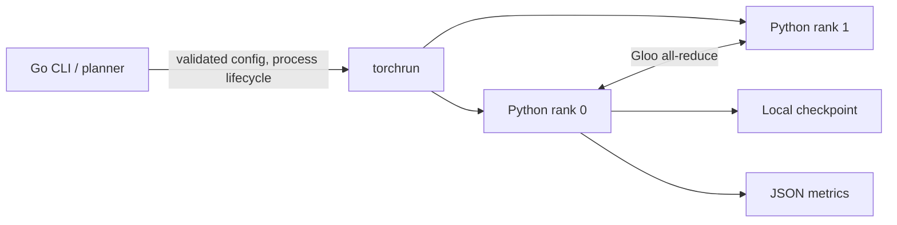

# TrainMesh

Adaptive distributed AI training engine written in Go and Python. Distribute model-training computation across machines and optimize compute, communication and training time.

TrainMesh currently runs **real single-host CPU DistributedDataParallel (DDP)** with PyTorch Gloo. It does not require a GPU. Cluster identity and local planning are implemented; remote enrollment, multi-machine process orchestration, automatic pilot selection, and fault recovery are not yet implemented. See [implementation status](docs/IMPLEMENTATION_STATUS.md) before treating this as a multi-machine release.



## Quick start

Requirements: Go 1.24+, Python 3.10+, CPU PyTorch with Gloo, and `uv` (or pip).

```bash
uv venv .venv
uv pip install --python .venv/bin/python -e 'python[test]'
go build -o bin/trainmesh ./cmd/trainmesh
./bin/trainmesh doctor
./bin/trainmesh plan --config examples/cpu-ddp.yaml
./bin/trainmesh run --config examples/cpu-ddp.yaml
```

The example trains a small MLP on the learnable synthetic `teacher` task, reports validation accuracy every epoch (chance is 25%), uses two CPU ranks, Gloo gradient synchronization, and saves a verified safetensors checkpoint in `checkpoints/latest/`. The global batch is `per_rank × world_size × accumulation_steps`; this example has `64 × 2 × 1 = 128`.

## Commands

- `trainmesh doctor` inspects Python, PyTorch, Gloo, and torchrun.
- `trainmesh cluster init` creates a local cluster identity; `cluster status` reports the local host.
- `trainmesh plan --config ...` validates supported settings and prints the resolved batch/world size.
- `trainmesh run --config ...` launches local CPU training through torchrun.
- `trainmesh benchmark --config ... --output benchmark-results/run.json` records actual runtime metrics.

Remote workers are deliberately reported as unsupported until the authenticated agent and multi-node launcher are complete. A local multi-process test is not a substitute for multi-machine validation. Multi-machine training is proven today by starting torchrun directly (minikube and physical-machine scripts in [E2E testing](docs/E2E_TESTING.md)); launching it through the CLI is Phase 1.

## Docs

- [Documentation index](docs/README.md) — what each document covers
- [Architecture review, target design and roadmap](docs/TRAINMESH_ARCHITECTURE.md) (start here)
- [Module map: how the current code works](docs/modules/README.md)
- [CPU backend setup](docs/CPU_BACKEND.md)
- [End-to-end and multi-machine testing](docs/E2E_TESTING.md)
- [Implementation status](docs/IMPLEMENTATION_STATUS.md)
- [Next steps (handoff)](docs/NEXT_STEPS.md)

License: Apache-2.0.
