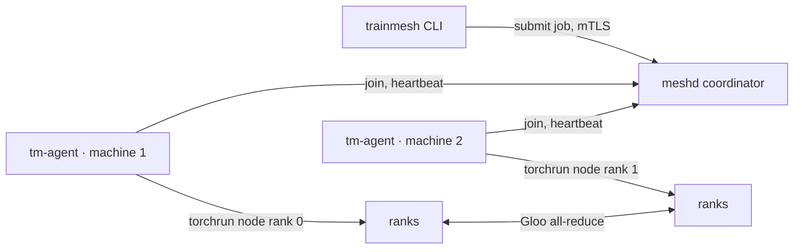

# TrainMesh

Adaptive distributed AI training engine written in Go and Python. Distribute model-training computation across machines and optimize compute, communication and training time.

TrainMesh runs **real CPU DistributedDataParallel (DDP)** with PyTorch Gloo, on one machine or across machines on a LAN. Machines join a coordinator (`meshd`) with single-use tokens over mTLS, report health through an agent (`tm-agent`), and train one job together through the `trainmesh` CLI. It does not require a GPU. GPU backends, training over the internet, large-model parallelism and automatic recovery are later phases. See [implementation status](docs/IMPLEMENTATION_STATUS.md) for what is verified, and on what.



## Quick start

Requirements: Go 1.24+, Python 3.10+, CPU PyTorch with Gloo, and `uv` (or pip).

```bash
uv venv .venv
uv pip install --python .venv/bin/python -e 'python[test]'
make build                  # bin/trainmesh, bin/meshd, bin/tm-agent
./bin/trainmesh doctor
./bin/trainmesh plan --config examples/cpu-ddp.yaml
./bin/trainmesh run --config examples/cpu-ddp.yaml
```

The example trains a small MLP on the learnable synthetic `teacher` task, reports validation accuracy every epoch (chance is 25%), uses two CPU ranks, Gloo gradient synchronization, and saves a verified safetensors checkpoint in `checkpoints/latest/`. The global batch is `per_rank × world_size × accumulation_steps`; this example has `64 × 2 × 1 = 128`.

## Commands

- `trainmesh doctor` inspects Python, PyTorch, Gloo, and torchrun.
- `trainmesh plan --config ...` validates supported settings and prints the resolved batch/world size.
- `trainmesh run --config ...` trains on this machine through torchrun.
- `trainmesh benchmark --config ... --output benchmark-results/run.json` records actual runtime metrics.
- `meshd` runs the coordinator; `trainmesh token create` prints a join string; `tm-agent --join '<join string>'` joins a machine; `trainmesh nodes` lists machines.
- `trainmesh run --config ... --coordinator host:7443` trains across `execution.workers` machines; `trainmesh job get|cancel` inspects or stops a job.

How to set up several machines: [modules/mesh.md](docs/modules/mesh.md). The mesh is verified on one Mac (two agents) and on a 2-node minikube cluster, with the same validation accuracy as one machine; two physical machines are still to be tested ([E2E testing](docs/E2E_TESTING.md)).

## Docs

- [Documentation index](docs/README.md) — what each document covers
- [Architecture review, target design and roadmap](docs/TRAINMESH_ARCHITECTURE.md) (start here)
- [Module map: how the current code works](docs/modules/README.md)
- [CPU backend setup](docs/CPU_BACKEND.md)
- [End-to-end and multi-machine testing](docs/E2E_TESTING.md)
- [Implementation status](docs/IMPLEMENTATION_STATUS.md)
- [Next steps (handoff)](docs/NEXT_STEPS.md)

License: Apache-2.0.
