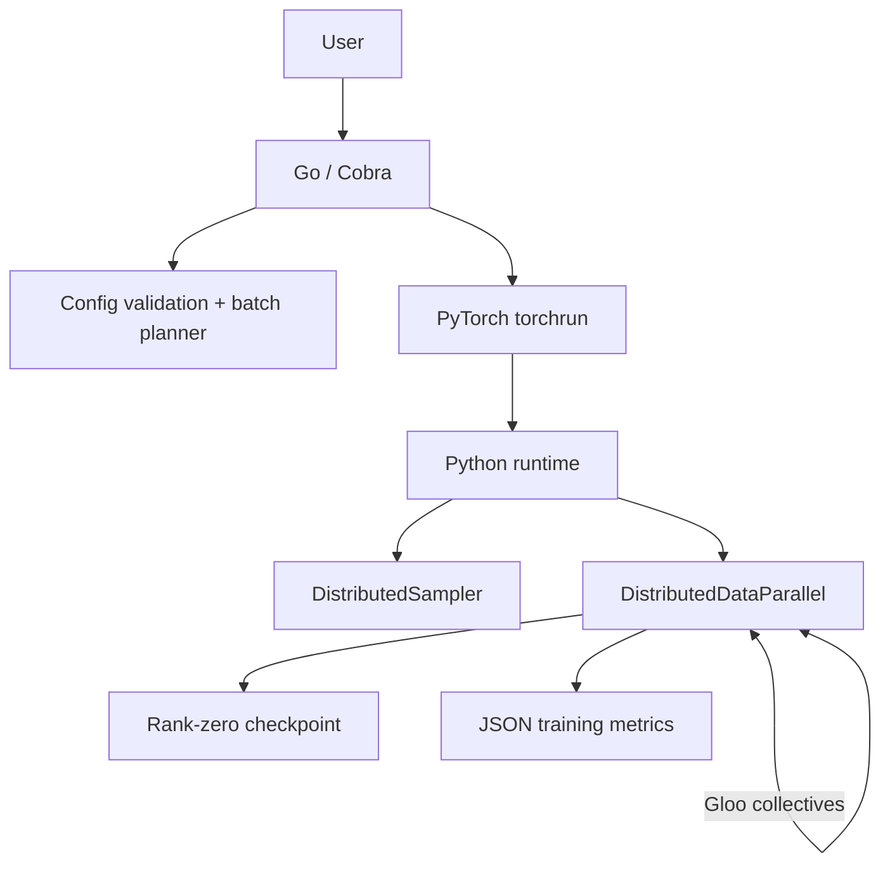

# Architecture

> **Superseded:** this page describes only the current single-host prototype. The review and the
> target multi-machine architecture live in [TRAINMESH_ARCHITECTURE.md](TRAINMESH_ARCHITECTURE.md).

The Go CLI validates the training configuration, computes world size and effective global batch, and owns the child process lifecycle. It starts PyTorch's `torch.distributed.run` launcher for a local CPU job. Python builds the model and deterministic synthetic dataset, assigns disjoint samples with `DistributedSampler`, wraps the model in `DistributedDataParallel`, aggregates sample-weighted epoch loss, and writes rank-zero checkpoints and result JSON. Tensor and gradient traffic remains in PyTorch/Gloo; it never travels through Go.

This initial implementation is a single-host runtime. A production remote control plane needs authenticated transport, short-lived single-use enrollment credentials, agent state/heartbeat persistence, per-node artifact/environment verification, and a coordinated torchrun rendezvous. Those boundaries are documented but not represented by placeholder APIs.
