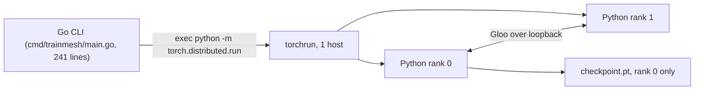
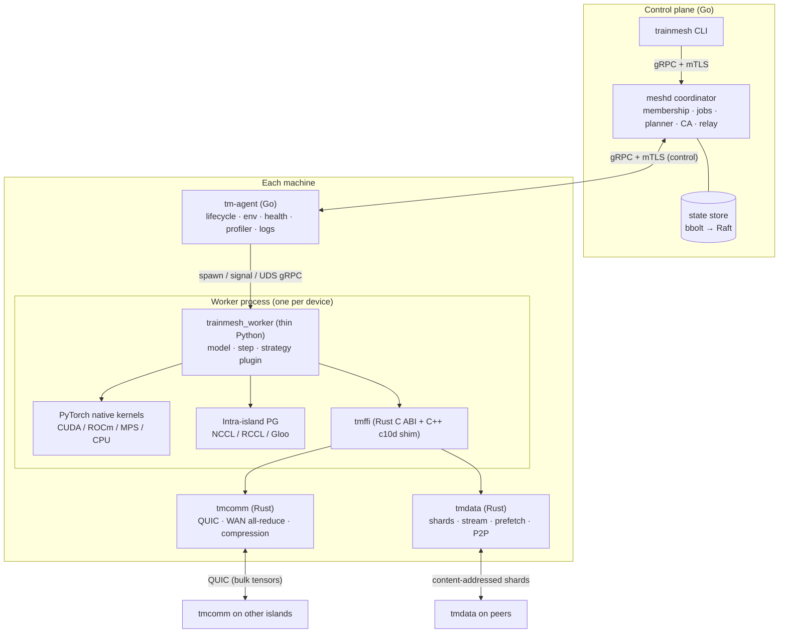
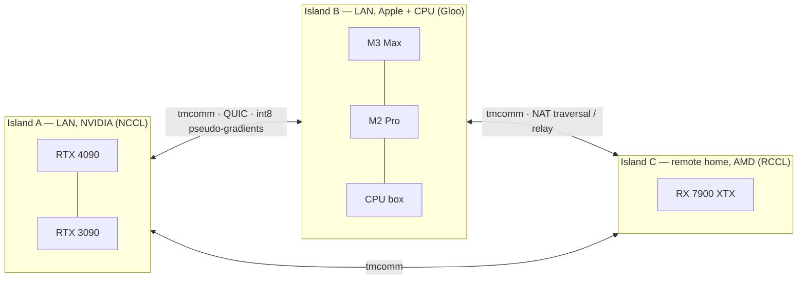
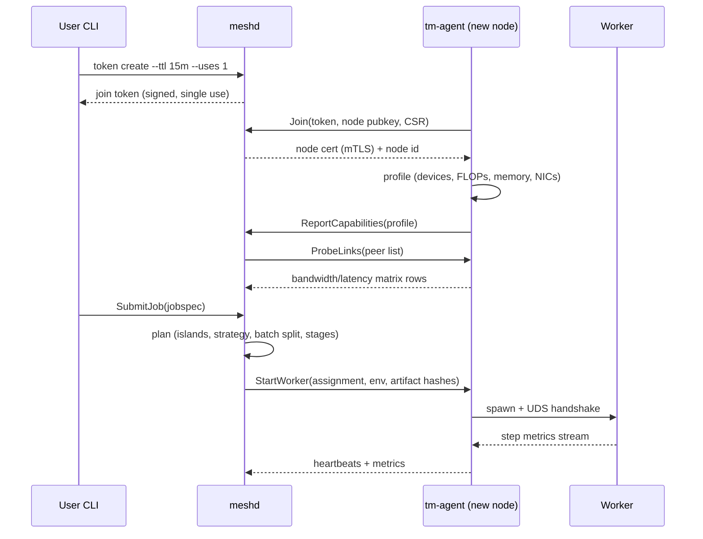
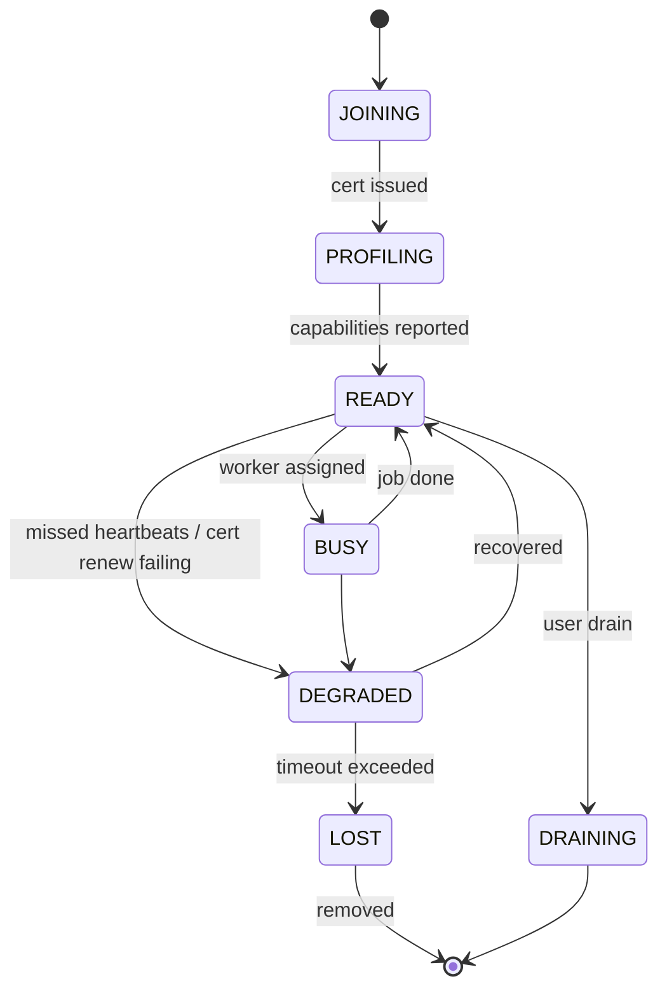
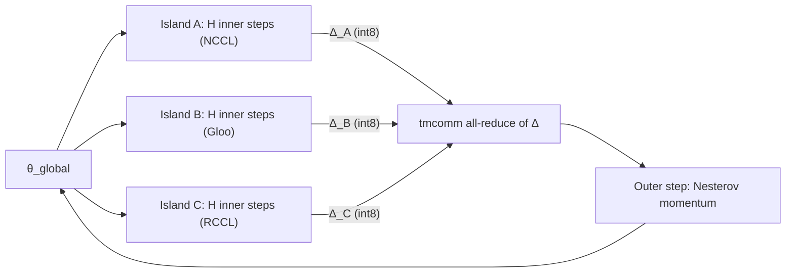
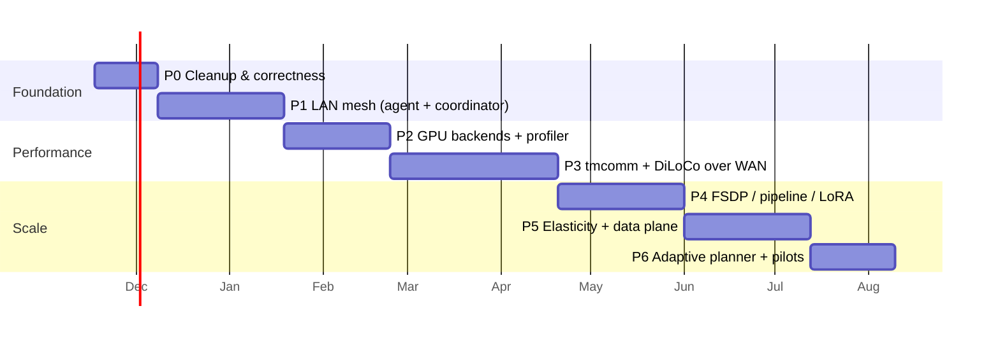

# TrainMesh — Architecture Review and Target Architecture

> Status: **authoritative design document**. Updated 2026-11-14.
> How the code works *today*, module by module: [modules/README.md](modules/README.md).
> What is implemented, with evidence: [IMPLEMENTATION_STATUS.md](IMPLEMENTATION_STATUS.md).
> Scope: what TrainMesh is meant to be, what exists today, what is wrong with it, the corrected
> architecture, and the phased path to build it.

---

## Table of contents

1. [Vision, goals and non-goals](#1-vision-goals-and-non-goals)
2. [Review of the current implementation](#2-review-of-the-current-implementation)
3. [What runs where: Python vs native](#3-what-runs-where-python-vs-native)
4. [Target architecture overview](#4-target-architecture-overview)
5. [Component specifications](#5-component-specifications)
6. [Device and backend matrix](#6-device-and-backend-matrix)
7. [Performance design](#7-performance-design)
8. [Target repository layout](#8-target-repository-layout)
9. [Corrective fix list for the existing code](#9-corrective-fix-list-for-the-existing-code)
10. [Phased roadmap with acceptance criteria](#10-phased-roadmap-with-acceptance-criteria)
11. [Testing strategy](#11-testing-strategy)
12. [Key decisions (ADR summaries)](#12-key-decisions-adr-summaries)
13. [Risks and open questions](#13-risks-and-open-questions)
14. [References](#14-references)

---

## 1. Vision, goals and non-goals

### 1.1 Vision

TrainMesh turns a set of ordinary machines into **one training resource mesh**. The machines can be
gaming PCs with NVIDIA or AMD GPUs, Apple Silicon Macs, or CPU-only boxes, on the same LAN or
spread across the internet. A user joins machines with one command. TrainMesh measures what each
machine and link can do, then trains models from small networks up to multi-billion-parameter LLMs
across them. It picks the parallelism strategy that gives the best throughput for that topology.

### 1.2 Goals

| # | Goal | Measurable target |
|---|------|-------------------|
| G1 | One-command join, LAN or internet | `trainmesh join <token>` → node `READY` in < 60 s, NAT included |
| G2 | Heterogeneous hardware in one job | NVIDIA + AMD + Apple + CPU nodes contribute to the same model |
| G3 | High performance after connecting | LAN island ≥ 85% linear scaling for DDP-sized models; WAN ≥ 60% compute utilisation with low-communication training |
| G4 | Scale from small models to LLMs | DDP → FSDP → pipeline → DiLoCo chosen automatically by model size × topology |
| G5 | Churn is normal | Loss of any non-coordinator node never loses more than one outer step / checkpoint interval of work |
| G6 | Secure by default | mTLS everywhere, single-use expiring join tokens, no pickle across the network |
| G7 | Evidence-based planning | Planner choices backed by measured profiles and pilot runs, logged with numbers |

### 1.3 Non-goals (for now)

- Writing our own tensor library or autograd. PyTorch kernels (ATen, CUDA, ROCm, MPS, oneDNN) are
  already native and highly tuned. We orchestrate them; we don't replace them.
- Public, permissionless "anyone can join" compute marketplaces with payments. The trust model is
  **a cluster owner plus invited nodes**. Untrusted volunteer compute is a later, separate design
  (see §13).
- Inference serving. Training and fine-tuning only.
- Kubernetes as a requirement. TrainMesh must run on bare desktops; K8s can be a deployment target later.

---

## 2. Review of the current implementation

### 2.1 What exists (≈ 900 lines)



| Area | Intended (TrainMesh vision) | Built today |
|------|-----------------------------|-------------|
| Connecting PCs | Join over LAN/internet, discovery, NAT traversal | **None.** `workers > 1` is rejected (`cmd/trainmesh/main.go:97`) |
| Node agent | Long-running daemon per machine | **None** |
| Coordinator / control plane | Membership, jobs, scheduling | **None.** `cluster init` writes a JSON file with a random id |
| Security | mTLS, join tokens, revocation | **None** |
| Resource profiling | Measured FLOPs, memory, bandwidth matrix | `runtime.NumCPU()` only |
| Planner | Strategy selection, pilot runs | Multiplies batch × world size (`internal/config/config.go:94-97`) |
| Devices | NVIDIA, AMD, Apple, CPU | CPU only, hard-rejected otherwise (`config.go:76`, `runtime.py:39`) |
| Parallelism | DDP, FSDP, pipeline, low-communication WAN | DDP only, one host |
| Data | Real datasets, streaming, sharding | In-memory `torch.randn` synthetic data (`runtime.py:130`) |
| Models | Transformers / LLMs | Two-layer MLP (`runtime.py:19-27`) |
| Fault tolerance | Elastic, resumable across membership change | Single-host resume with an identical world size only (`runtime.py:162`) |

**Verdict:** the code is a reasonable *local DDP smoke test*, not a mesh. The core of the product
(agent, transport, membership, scheduling, heterogeneity, WAN-efficient training) has not started.

### 2.2 Is "too much Python" the real problem?

Partly, but not in the way it looks.

- The **training math is already native.** `model(x)`, `.backward()` and the DDP all-reduce run in
  C++ (ATen + Gloo). Python only issues calls. Rewriting that loop in Go would gain nothing and would
  lose the whole PyTorch ecosystem.
- The **real performance killers** for a networked mesh are communication volume, stragglers, host
  synchronisation and data stalls. The current code makes each of these worse (§2.3).
- What **should** be native, and is missing entirely: the node agent, membership, transport, NAT
  traversal, compression, cross-island collectives, data distribution and the profiler. That's where
  Go and Rust belong (§3).

### 2.3 Concrete defects

Severity: **P0** = blocks performance or safety of the mesh; **P1** = correctness/maintainability;
**P2** = hygiene.

#### Performance

| Sev | Location | Problem | Why it matters on a mesh |
|-----|----------|---------|--------------------------|
| P0 | `python/trainmesh_runtime/runtime.py:187-201` | Gradient accumulation calls `backward()` on every micro-batch inside DDP without `model.no_sync()`. DDP all-reduces gradients on **every** micro-batch, not once per optimizer step. | With `accumulation=8` this sends 8× the necessary traffic. On a 1 Gbps or internet link, that's the difference between usable and unusable. |
| P2 | `cmd/trainmesh/main.go:132,176` + `runtime.py:119` | Forces `OMP_NUM_THREADS=1` with no way to change it. | **Corrected after measurement (Phase 0):** on a 12-core Apple Silicon host, 3–6 threads per rank were 5–10% *slower* for small MLPs and at most ~7% faster at hidden=4096, so 1 thread is a sound default. The real gap is that it couldn't be tuned; it now can via `execution.cpu_threads_per_rank` or `OMP_NUM_THREADS`. Idle cores are better used with more ranks or bigger per-rank work. |
| P0 | `runtime.py:133` | `DistributedSampler` gives every rank the same number of samples. | In a heterogeneous mesh, the slowest PC sets the pace for everyone. Batches must be sized by measured throughput (§5.6). |
| P1 | `runtime.py:202` | `loss.detach().item()` every step. | Forces a device → host sync each step. On GPU this serialises the CUDA stream and kills compute/comm overlap. Accumulate on device; read once per log interval. |
| P1 | `runtime.py:135` | `DataLoader` with `num_workers=0`, no `pin_memory`, no prefetch. | Data loading runs on the training thread. Real datasets will stall GPUs. |
| P1 | `runtime.py:128-131` | Every rank materialises the full dataset in RAM. | Doesn't scale past toy sizes; no streaming or sharding. |
| P1 | `runtime.py:212-214` | Rank 0 writes a full synchronous checkpoint every epoch while other ranks wait at the next collective. | Large models stall the whole job for minutes. Needs async, sharded checkpoints. |
| P1 | `runtime.py:99,159` | `read_bytes()` loads the whole checkpoint into RAM to hash it. | Multi-GB checkpoints → memory spike. Stream the hash (BLAKE3/SHA-256 in chunks). |

#### Security and correctness

| Sev | Location | Problem | Fix |
|-----|----------|---------|-----|
| P0 | `runtime.py:164` | `torch.load(..., weights_only=False)` unpickles arbitrary objects. | Once checkpoints travel between peers, this is **remote code execution**. Use safetensors for tensors and JSON for metadata; never unpickle network data. |
| P1 | `runtime.py:221` | `dist.all_gather_object` uses pickle over the wire. | Exchange fixed-size digest tensors instead. |
| P1 | `runtime.py:83-84,174-175` | Only rank 0's RNG state is saved; on resume every rank restores rank 0's state. | Per-rank RNG streams diverge from the original run; resume isn't faithful. Save per-rank RNG state. |
| P1 | `runtime.py:233` | `samples_per_second` is computed from the configured dataset size, not samples actually processed. | Benchmarks are wrong after sampler padding, resume or early stop. Count real samples. |
| P1 | `runtime.py:237` | The results path is read from the top-level `optimizer` key. | Name collision with `training.optimizer`; confusing. Rename to `run.results_path` or `planner.results_path`. |
| P1 | `cmd/trainmesh/main.go:128,173` | `exec.CommandContext` kills only the direct child (`torchrun`) on cancel. | Rank processes can be orphaned. Start the child in its own process group and signal the group (`SIGTERM` → grace → `SIGKILL`). |
| P1 | `cmd/trainmesh/main.go:118,164,234-241` | `freeTCPPort` closes the listener and passes the port on: a TOCTOU race. | Another process can grab the port. Let the rendezvous owner bind and report its port, or retry on bind failure. |
| P1 | `cmd/trainmesh/main.go:159-160` | `filepath.Abs` errors ignored in `benchmark`. | Silent bad paths. Handle every error. |
| P2 | `cmd/trainmesh/main.go:51,82,208,225` | `json.MarshalIndent` errors ignored. | Handle errors or use an encoder helper. |

#### Structure and maintainability

| Sev | Location | Problem | Fix |
|-----|----------|---------|-----|
| P1 | `cmd/trainmesh/main.go:90-185` | `run` and `benchmark` duplicate launcher logic (args, env, port, interface). | One `internal/launcher` package with a typed `LaunchSpec`. |
| P1 | `cmd/trainmesh/main.go` (all) | All logic in `package main`; no tests possible. | Thin `main`, logic in `internal/*` packages with interfaces at IO edges. |
| P1 | `internal/config/config.go:34-40` vs `runtime.py:30-51` | Two independent config validators. Go doesn't know `model` or `training.optimizer`; Python re-validates differently. | One schema (`proto/trainmesh/v1/jobspec.proto`) generating Go, Rust and Python types (§5.13). |
| P1 | `runtime.py:104-245` | One 140-line `train()` that does config, process group, data, model, optimiser, resume, loop, checkpoint, metrics. | Split into strategy, data, checkpoint and metrics modules with a small trainer loop. |
| P2 | `cmd/trainmesh/main.go:60-69,112` | Python and module paths resolved relative to the current directory. | Resolve from install location or config; the agent owns the environment. |
| P2 | `cmd/trainmesh/main.go:133-135,207` | Hardcoded `GLOO_SOCKET_IFNAME=lo0` and cluster name `local-cpu-cluster`. | Interface selected by the profiler; cluster name from flags/config. |
| P2 | `cmd/trainmesh/main.go:41` | Capability probe is an inline Python one-liner. | Move to `trainmesh_worker.probe` returning a typed JSON capability report. |
| P2 | Repository root | Not a git repository; built binaries (`./trainmesh`, `bin/`), `.venv/`, `checkpoints/` present locally (already in `.gitignore`). | `git init`, first commit, CI with lint + tests. |

### 2.4 Architectural flaws (beyond individual bugs)

1. **Static `torchrun` world with a c10d master.** Every rank must reach `MASTER_ADDR:PORT` directly.
   That doesn't work across NAT, and any node loss kills the whole job.
2. **One flat process group.** NCCL can't include AMD or Apple devices, and Gloo over the internet is
   synchronous and latency-bound. A heterogeneous WAN mesh needs a **hierarchy**: fast homogeneous
   islands joined by a WAN-aware layer (§5.5).
3. **No control plane / data plane split.** The CLI is both the operator and the job. There's
   no long-running agent to own processes, environments, health and logs on each machine.
4. **Synchronous every-step communication as the only strategy.** Fine on NVLink; infeasible on
   home internet (worked numbers in §7.1).

---

## 3. What runs where: Python vs native

### 3.1 Principle

> Put each piece of work in the language whose runtime is best at it. Never move tensors through a
> language that can't keep them on the device.

| Concern | Hot path? | Owner | Why |
|---------|-----------|-------|-----|
| Forward/backward kernels | Yes | **PyTorch native** (ATen/CUDA/ROCm/MPS/oneDNN) | Already C++/CUDA. Python is a thin call layer; `torch.compile` removes most Python overhead. |
| Intra-island collectives | Yes | **NCCL / RCCL / Gloo** (native) | Vendor-tuned. Never reimplement. |
| Cross-island / WAN collectives, compression | Yes | **Rust `tmcomm`** | Needs async IO, QUIC, quantisation kernels, zero-copy buffers, no GIL. Rust gives C-level speed with memory safety. |
| Data streaming, sharding, prefetch, P2P distribution | Yes | **Rust `tmdata`** | IO + decode throughput, mmap, zero-copy handoff via DLPack; the GIL can't stall it. |
| Model definition, training-step glue, HF integration | Light | **Python `trainmesh_worker`** | The ecosystem lives here. Kept thin: no IO loops, no networking, no scheduling. |
| Node agent (process lifecycle, env, health, logs) | No (control) | **Go `tm-agent`** | Excellent concurrency, single static binary, easy cross-compile for macOS/Linux/Windows. |
| Coordinator, membership, scheduling, API | No (control) | **Go `meshd`** | Same; mature libraries for gRPC, mTLS, gossip, Raft, bbolt. |
| Profiler (FLOPs microbench, bandwidth probes) | Startup | Go orchestrates; device FLOPs via a Python/PyTorch probe; network probes in Rust | Measure with the same stack the job will use. |
| CLI | No | **Go** (existing Cobra) | Keep. |

### 3.2 Why not Go for the data plane?

Go is the right choice for the control plane. For the data plane it has three drawbacks:
- It has no zero-copy path into PyTorch tensors that is safe with Go's moving GC and cgo overhead
  per call.
- It has poor SIMD support for quantisation and compression kernels.
- It has no clean way to build a PyTorch c10d backend (C++ ABI).

Rust exposes a C ABI, works with `cxx` for the C++ c10d shim, supports DLPack, and has a strong QUIC
stack (`quinn`). That's why the hot path uses **Go + Rust**.

### 3.3 Boundary rules

1. Tensors cross language boundaries only by **DLPack / pinned shared memory**, never by
   serialisation.
2. Python never opens network sockets for training traffic. It calls `tmcomm` or the native
   process group.
3. The Go agent never touches tensor bytes. It handles control messages, process lifecycle and file
   paths only.
4. Control traffic uses gRPC over mTLS. Bulk traffic uses `tmcomm` over QUIC (or raw TCP on a
   trusted LAN).

---

## 4. Target architecture overview

### 4.1 Layers



### 4.2 Islands: the central topology idea

An **island** is a set of workers that share a compatible collective backend **and** a fast link.
Inside an island we use the best vendor library. Between islands we use `tmcomm` with
low-communication algorithms.



### 4.3 Control flow: join → profile → plan → run



---

## 5. Component specifications

Each component lists responsibilities, interfaces, failure handling and tunables. Tunables are
config values with safe defaults, read once at start-up into a typed, validated config.

### 5.1 Identity and security

**Responsibilities**
- Cluster CA owned by `meshd` (Ed25519 keys). Every node gets a short-lived X.509 cert (default
  24 h, auto-renewed) bound to its node id.
- **Join tokens**: random 256-bit secret, single use, TTL (default 15 min), scoped to the cluster.
  Only a hash is stored. Revocable.
- All control traffic uses **mTLS** (gRPC). All `tmcomm` traffic uses QUIC with mutual TLS, using
  the same certs.
- **Signed job specs**: the coordinator signs each assignment, and the agent verifies the signature
  before it spawns anything.
- **Artifacts**: model weights and checkpoints use **safetensors** with BLAKE3 content hashes.
  Never pickle.
- **User code**: runs as the agent's unprivileged user. An optional OS sandbox (Linux namespaces /
  macOS sandbox profile) comes in a later phase.

**Failure handling**: an expired or reused token is fatal and non-retryable, with a clear message.
Cert renewal failure is recoverable: the agent retries with backoff and goes `DEGRADED` before the
cert expires.

**Tunables**: `security.token_ttl`, `security.cert_ttl`, `security.renew_before`.

### 5.2 Connectivity and NAT traversal

- **LAN discovery**: mDNS (`_trainmesh._udp`) advertises the coordinator and peers. Discovery only;
  joining still requires a token.
- **Internet**:
  1. The agent keeps an outbound mTLS connection to `meshd`, so no inbound port is needed for
     control.
  2. Peer data paths try direct QUIC first. Each peer learns its public address from STUN-style
     reflection on `meshd`, then both sides punch holes at the same time.
  3. If that fails, traffic goes through a **relay** (built into `meshd` or a separate `tm-relay`),
     and the planner treats relayed links as low-bandwidth.
  4. Optional **WireGuard overlay** mode for users who prefer a flat L3 network. It can also be
     brought by the user (Tailscale/Headscale-style networks).
- Interface selection is automatic: the profiler picks the NIC used for each peer link. This
  replaces the hardcoded `lo0`.

**Tunables**: `net.quic_port`, `net.relay_enabled`, `net.stun_timeout`, `net.prefer_wireguard`.

### 5.3 Membership and state

- **Failure detection**: SWIM-style gossip (`hashicorp/memberlist`) among agents, plus heartbeats
  to `meshd`. Gossip catches peer failures quickly without the coordinator in the loop.
- **Coordinator state**: start with embedded **bbolt** (single coordinator). Move to `hashicorp/raft`
  (3 coordinators) when HA is needed. State covers nodes, certs, tokens, jobs, assignments and
  checkpoints index.
- **Node lifecycle**:



**Tunables**: `membership.heartbeat_interval` (default 2 s), `membership.suspect_after` (≥ 3×
interval), `membership.lost_after`.

### 5.4 Resource profiler

Runs at join time and periodically (cheap probes) or on demand.

| Measurement | How | Used for |
|-------------|-----|----------|
| Device inventory | `nvidia-smi`/NVML, `rocm-smi`, `system_profiler` / IOKit, `/proc/cpuinfo` (via agent) | Island formation, backend choice |
| Usable memory | VRAM free; unified memory on Apple (with a reserve for the OS); system RAM | Shard/stage sizing, OOM avoidance |
| Achieved TFLOPs (bf16/fp16/fp32) | Short PyTorch matmul microbenchmark in the worker env | Throughput-proportional batch sizing |
| Memory bandwidth | Device copy benchmark | Pipeline-stage cost model |
| Link bandwidth/latency matrix | Rust `tmcomm` probes between peers (QUIC bulk + RTT pings) | Islands, all-reduce topology, strategy choice |
| Stability | Recent uptime, battery/thermal state (laptops) | Placement priority, avoid laptops for pipeline-critical stages |

Profiles are versioned and stored by `meshd`. The planner uses them, and pilot runs refine them.

### 5.5 Topology and islands

**Island formation algorithm** (pure function; easy to unit test):
1. Group workers by **collective backend family**: `nccl` (NVIDIA), `rccl` (AMD), `gloo-cpu`
   (CPU and Apple; MPS has no PyTorch distributed backend, so Apple tensors are staged to CPU memory,
   which is cheap on unified memory).
2. Inside each family, build a graph with an edge when measured bandwidth ≥
   `topology.island_min_gbps` (default 5 Gbps) and RTT ≤ `topology.island_max_rtt_ms` (default 2 ms).
3. Islands = connected components. A single machine with several GPUs is always one island.
4. Mixed-vendor machines on the same LAN become separate islands that sync through `tmcomm` with a
   higher sync frequency than WAN islands (the planner tunes this).

**Collectives**
- Intra-island: native PyTorch process group (NCCL / RCCL / Gloo).
- Inter-island: `tmcomm` hierarchical scheme: reduce inside the island → island leaders exchange over
  WAN (ring or tree, chosen by the bandwidth matrix) → broadcast inside the island.

### 5.6 Planner / scheduler

The planner is a **pure core with an imperative shell**. A pure function takes
`(JobSpec, []NodeProfile, LinkMatrix)` and returns a `Plan`. The shell runs pilots and dispatches.

**Cost model inputs**: model parameter count and activation footprint (estimated from the spec, then
measured in the pilot), per-worker TFLOPs and memory, and link bandwidth/latency.

**Decisions**
1. **Strategy** (see §5.7) per island and across islands.
2. **Throughput-proportional micro-batches**: worker *i* gets `b_i ∝ measured_samples_per_sec_i`.
   The global batch stays fixed, so the optimizer semantics don't change. This replaces the
   equal-share `DistributedSampler`.
3. **Pipeline stage partitioning** (large models): assign contiguous layer ranges with
   `cost(stage) ∝ memory_i, FLOPs_i`, using dynamic programming over layers to minimise the slowest
   stage.
4. **Sync frequency** for DiLoCo: inner steps `H` chosen so the outer sync (compressed) fits inside
   `H × step_time` for overlap.
5. **Pilot runs** (the original "adaptive pilot optimizer"): run the top-K candidate plans for N
   steps each, measure real step time / comm time / memory, and pick the best. Every decision is
   logged with its numbers.

**Re-planning** happens on membership change, persistent stragglers (> `planner.straggler_ratio`
slower than predicted for M steps), or OOM.

### 5.7 Training strategies

| Model size (params) | Within an island | Across islands (LAN, mixed vendor) | Across islands (internet) |
|---------------------|------------------|------------------------------------|---------------------------|
| < 1B, fits on every device | DDP (bucketed, overlapped, `no_sync` accumulation) | DiLoCo with small `H` (e.g. 10–50) or synchronous compressed all-reduce (PowerSGD/bf16) | DiLoCo, `H` ≈ 100–500, int8 pseudo-gradients |
| 1–13B, doesn't fit one device | FSDP / ZeRO-3 sharding inside the island; LoRA/QLoRA for fine-tunes | DiLoCo between FSDP islands | DiLoCo between FSDP islands; LoRA makes pseudo-gradients tiny |
| Larger than an island's memory | Pipeline parallel across machines in the island (1F1B schedule) | SWARM-style heterogeneous pipeline: stages replicated, dynamic routing around slow/failed peers | Same; pipeline only over the best links, otherwise DiLoCo over replicas |
| Fine-tuning any size | LoRA / QLoRA (4-bit base) with DDP or FSDP | DiLoCo on adapter weights only | DiLoCo on adapter weights only (MBs, not GBs) |

**DiLoCo in brief**: each island trains independently for `H` inner steps with AdamW. Then islands
exchange **pseudo-gradients** (`θ_start − θ_now`), average them, and apply an outer Nesterov-momentum
step. Communication drops by roughly a factor of `H`, and a slow or lost island only delays or drops
one contribution.



Strategies are **plugins** in a registry (`trainmesh_worker/strategies/`). Adding one never means
editing a central `if` chain.

### 5.8 `tmcomm` — Rust communication layer

**Responsibilities**
- Transport: QUIC (`quinn`) with mTLS. Multiple streams per peer avoid head-of-line blocking. Plain
  TCP is allowed on a trusted LAN.
- Collectives across islands: all-reduce (ring, tree, hierarchical), broadcast, all-gather, and
  reduce-scatter. The topology comes from the bandwidth matrix.
- **Compression**: bf16/fp16 casting; **int8 / int4 block quantisation with error feedback**;
  top-k sparsification with error feedback; PowerSGD low-rank. SIMD kernels on CPU; for GPU tensors,
  quantise on device before transfer (CUDA/HIP kernel or PyTorch ops) to cut PCIe and network bytes.
- **Overlap**: chunked, pipelined transfers. For DiLoCo, the *streaming* variant syncs parameter
  fragments while the next inner steps run.
- **Async and partial participation**: an outer step can complete with a quorum
  (`comm.outer_quorum`, default 2/3 of islands) after `comm.outer_timeout`; late contributions are
  folded into the next round or discarded.

**PyTorch integration** (in `native/tmffi`)
1. `ProcessGroupTM`: a C++ c10d backend shim registered with `torch.distributed.Backend.register_backend`.
   It calls Rust through `cxx`, so standard `dist.all_reduce` works on a `tm` group.
2. A DDP **comm hook** for compressed synchronous all-reduce.
3. A direct Python API (`tmcomm.outer_sync(params, ...)`) for DiLoCo. Tensors pass by **DLPack**;
   CPU staging buffers are pinned and reused (no allocation per step).

**Failure handling**: peer timeout → recoverable, with bounded retries
(`comm.max_retries`, exponential backoff). Retries exhausted → `PeerUnavailable`, so the planner
drops that peer from the round. A checksum mismatch on a chunk → resend the chunk once, then mark the
peer suspect.

**Tunables**: `comm.chunk_bytes`, `comm.streams_per_peer`, `comm.compression`
(`none|bf16|int8|int4|topk|powersgd`), `comm.error_feedback`, `comm.outer_quorum`,
`comm.outer_timeout`, `comm.max_retries`.

### 5.9 `tmdata` — Rust data plane

- **Content-addressed shards**: datasets are pre-tokenised into fixed-size shards (e.g. 64–256 MB)
  addressed by BLAKE3 hash, with a manifest listing them. Model weights use the same mechanism.
- **Distribution**: peers fetch shards from the nearest peer that has them (BitTorrent-style swarm
  inside the cluster), with an origin fallback (local path, HTTP, S3-compatible). Every chunk is
  hash-verified.
- **Streaming loader**: mmap + read-ahead + decode on Rust threads into a ring of pinned buffers.
  Batches go to Python via **DLPack** without copies. The GIL is never held during IO.
- **Deterministic, resumable cursor**: the global sample order is a seeded permutation over
  `(shard, offset)`. Each worker's cursor is part of the checkpoint, so resuming with a *different*
  world size re-partitions the remaining samples exactly.
- **Heterogeneous batches**: workers ask for `b_i` samples per step, as assigned by the planner.

**Tunables**: `data.shard_bytes`, `data.prefetch_batches`, `data.io_threads`, `data.cache_dir`,
`data.cache_max_bytes`.

### 5.10 Worker runtime (thin Python)

`python/trainmesh_worker/` replaces `trainmesh_runtime`. It is deliberately small.

- **Bootstrap**: the agent spawns the worker with a Unix-domain-socket address. The worker fetches
  its signed assignment (job spec, rank info, island PG params, data cursor) over local gRPC.
- **Device abstraction** (`devices/`): `cuda`, `rocm` (PyTorch exposes it as `cuda`), `mps` and
  `cpu`. Each provides `device()`, `autocast_dtype()`, `collective_backend()`,
  `max_memory_bytes()`, and `stage_to_host(tensor)`.
- **Performance defaults**: `torch.compile` where supported; AMP (bf16 on Ampere+/RDNA3/CPU with
  AMX, fp16 on MPS / older GPUs); fused optimizers; gradient accumulation under `no_sync()`; metrics
  accumulated on device and read every `log_interval` steps; CPU threads per rank chosen from
  measurements by the profiler/pilot (default 1, see §2.3).
- **Models** (`models/`): Hugging Face `transformers` / PEFT loaders plus user plugins registered
  by entry point.
- **Strategies** (`strategies/`): `ddp`, `fsdp`, `pipeline`, `diloco`, and `lora`, composable
  (e.g. `diloco(fsdp)`).
- **Metrics**: per step it reports compute ms, comm ms, data-wait ms, idle ms, samples and tokens to
  the agent (UDS stream). No direct network access.

### 5.11 Fault tolerance and elasticity

| Failure | Detection | Response |
|---------|-----------|----------|
| Worker crash inside an island | Agent sees exit; peers see NCCL/Gloo error | Agent reports → planner restarts the island's PG with the remaining members (new rendezvous id). Resume from the latest island checkpoint or from peers' in-memory replicas. |
| Whole island lost (internet) | Gossip + missed heartbeats | DiLoCo continues with the remaining islands (quorum). The planner re-plans; the island rejoins at the next outer step with `θ_global`. |
| Coordinator lost | Agents lose the control stream | Running jobs continue (the data plane is peer-to-peer). New scheduling waits for the coordinator. HA via Raft in a later phase. |
| Straggler | Step-time telemetry vs prediction | Rebalance `b_i`; if it persists, demote it to a lower-priority role or drop it from the island. |
| Corrupted checkpoint/shard | Hash mismatch | Fetch from another replica; never load unverified data. |

**Checkpoints**: sharded with `torch.distributed.checkpoint` (DCP) into **safetensors** shards plus a
JSON manifest (hashes, step, data cursors, per-rank RNG). Written **asynchronously** (snapshot to
host memory, write in the background). Replicated to `ckpt.replicas` peers (default 2) through
`tmdata`. DCP's resharding allows resuming on a different world size.

### 5.12 Observability

- **Logs**: structured JSON with `cluster_id`, `job_id`, `node_id`, `rank`, `step` on every line;
  one logger per component.
- **Metrics**: Prometheus endpoint per agent and coordinator: step time breakdown, tokens/s, comm
  bytes (raw vs compressed), link utilisation, GPU utilisation/memory, queue depth, heartbeat age.
- **Traces**: OpenTelemetry spans for join, plan, pilot, outer sync, and checkpoint.
- **UX**: `trainmesh status` / `trainmesh top` (TUI) and an optional web dashboard served by `meshd`.

### 5.13 Single job-spec schema

The schema is defined once, in `proto/trainmesh/v1/jobspec.proto`, and generates Go
(`protoc-gen-go`), Rust (`prost`) and Python (`betterproto` / `protobuf`) types. YAML is parsed into
it at the CLI. This removes the duplicated validators.

**Implemented in Phase 0 (2026-11-16).** The rules live *in the schema* as
[protovalidate](https://protovalidate.com) annotations, and both the Go CLI
(`buf.build/go/protovalidate`) and the Python runtime (`protovalidate` 1.x on Google `protobuf`)
evaluate them, so the runtime is safe even when started by hand with torchrun. Details:
[modules/config.md](modules/config.md). The sketch below is the *target* (v2) shape; the
implemented v1 schema mirrors today's YAML.

Sketch:

```protobuf
syntax = "proto3";
package trainmesh.v1;

message JobSpec {
  string name = 1;
  uint64 seed = 2;
  ModelSpec model = 3;
  DataSpec data = 4;
  OptimSpec optim = 5;
  BatchSpec batch = 6;
  StrategySpec strategy = 7;   // "auto" lets the planner choose
  CheckpointSpec checkpoint = 8;
  Placement placement = 9;     // node selectors, min memory, allow_wan
}

message BatchSpec {
  uint32 global_batch = 1;     // fixed; planner splits it across workers by throughput
  uint32 micro_batch_max = 2;
}

message StrategySpec {
  oneof kind {
    Auto auto = 1;
    DDP ddp = 2;
    FSDP fsdp = 3;
    Pipeline pipeline = 4;
    DiLoCo diloco = 5;
  }
  bool lora = 10;
}

message DiLoCo {
  uint32 inner_steps = 1;          // H
  string outer_optimizer = 2;      // "nesterov"
  float outer_lr = 3;
  string compression = 4;          // none|bf16|int8|int4
  float quorum = 5;
  bool streaming = 6;
}
```

Config v2 YAML (what a user writes):

```yaml
version: 2
job:
  name: llama-ft-demo
  seed: 42
  model:
    source: hf://meta-llama/Llama-3.2-1B
    precision: auto            # bf16 where supported, fp16 on MPS
  data:
    manifest: tmdata://datasets/alpaca-tokenized/manifest.json
  optim: { name: adamw, lr: 2e-4, weight_decay: 0.0 }
  batch: { global_batch: 256, micro_batch_max: 8 }
  strategy:
    auto: {}                   # or: diloco: { inner_steps: 300, compression: int8 }
    lora: true
  checkpoint: { every_steps: 500, replicas: 2 }
  placement: { allow_wan: true, min_device_memory_gb: 8 }
```

Version 1 configs stay loadable (mapped onto v2 by the CLI) during a transition period.

### 5.14 API surface (gRPC)

| Service | RPC | Purpose |
|---------|-----|---------|
| `Coordinator` | `Join(JoinRequest) → JoinResponse` | Token + CSR → node cert, node id |
| | `Heartbeat(stream HeartbeatMsg) → stream Directive` | Liveness, metrics summary, directives back |
| | `ReportCapabilities(NodeProfile)` | Profiler output |
| | `ReportLinks(LinkMatrixRows)` | Bandwidth/latency probes |
| | `SubmitJob(JobSpec) → JobRef` / `WatchJob(JobRef) → stream JobEvent` / `CancelJob` | Job lifecycle |
| | `CreateToken`, `RevokeToken`, `DrainNode`, `RemoveNode` | Admin |
| `Agent` | `StartWorker(SignedAssignment)` / `StopWorker` / `StreamLogs` | Worker lifecycle on a node |
| | `ProbeLinks(PeerList) → LinkMatrixRows` | Network measurement |
| `WorkerLocal` (UDS) | `GetAssignment`, `ReportStep(stream StepMetrics)`, `RequestReplan` | Worker ↔ agent |

---

## 6. Device and backend matrix

| Device | PyTorch compute backend | Intra-island collective | Default precision | Notes / limits |
|--------|-------------------------|-------------------------|-------------------|----------------|
| NVIDIA GPU | CUDA | **NCCL** | bf16 on Ampere and newer, fp16 + loss scaling on older | Best-supported path. Multi-GPU in one box = one island. |
| AMD GPU | ROCm (exposed as `cuda` device in PyTorch) | **RCCL** (via PyTorch's `nccl` backend name on ROCm builds) | bf16 where the card supports it | Official ROCm support for consumer Radeon cards is limited and Linux-first. The profiler must verify, not assume. |
| Apple Silicon | MPS | **Gloo on CPU-staged tensors** (no MPS distributed backend) | fp16 (bf16 only where the macOS/PyTorch version supports it per op) | Unified memory makes staging cheap. MPS op coverage gaps need a CPU fallback (`PYTORCH_ENABLE_MPS_FALLBACK=1`) with a warning in metrics. |
| CPU (x86 / ARM) | ATen + oneDNN | **Gloo** | fp32; bf16 on CPUs with AMX/AVX512-BF16 | Threads per rank are measured, not assumed (default 1; extra threads helped little in Phase 0 measurements). Best used for small models or as DiLoCo replicas. |
| Any device, across islands | — | **`tmcomm`** | Compressed (bf16/int8/int4) | Works between any combination above. |

---

## 7. Performance design

### 7.1 Why every-step synchronous DDP can't work across the internet (arithmetic)

Assume a **1B-parameter** model.

| Quantity | Value |
|----------|-------|
| Gradient size, fp32 | 1B × 4 B = **4 GB** |
| Ring all-reduce bytes per node per step | ≈ 2 × 4 GB = **8 GB** |
| Time per step at 1 Gbps LAN (125 MB/s) | ≈ **64 s** of communication |
| Time per step at 100 Mbps home upload (12.5 MB/s) | ≈ **640 s** |

A consumer GPU does a forward/backward step for such a model in well under a second, so
synchronous DDP would leave GPUs idle more than 98% of the time.

**With DiLoCo (`H = 500`) and int8 pseudo-gradients:**

| Quantity | Value |
|----------|-------|
| Pseudo-gradient size, int8 | 1B × 1 B = **1 GB** |
| Ring bytes per node per outer step | ≈ **2 GB**, once every 500 steps |
| Average per step | ≈ **4 MB/step** (vs 8 GB/step) → about **2000× less traffic** |
| Outer sync at 100 Mbps | ≈ 160 s. If an inner step is 0.5 s, 500 steps = 250 s of compute, so a streaming/overlapped sync can hide it. |

With LoRA (adapters ≈ 0.1–1% of parameters), pseudo-gradients shrink to tens of MB, and even
`H = 50` is cheap.

These are back-of-envelope numbers, not benchmarks. The planner uses measured values (§5.4, §5.6).

### 7.2 Performance rules for every layer

1. **No per-step host syncs** in the worker (`.item()`, `.cpu()`, printing tensors). Read metrics
   every `log_interval` steps.
2. **Accumulate under `no_sync()`**; communicate once per optimizer step.
3. **Overlap communication with compute**: DDP bucket all-reduce during backward (tune
   `bucket_cap_mb`); FSDP prefetch; streaming DiLoCo outer sync during inner steps.
4. **Reuse pinned buffers**; no allocation in hot loops (Rust ring buffers, `torch.empty` once).
5. **Throughput-proportional work**, so no worker waits on the slowest (§5.6).
6. **Compress at the narrowest link only**: raw inside NVLink/PCIe islands, int8/int4 across WAN.
7. **Data never stalls compute**: `tmdata` prefetch depth tuned so data-wait ms ≈ 0 in the
   step-breakdown metrics.
8. **Measure everything**: every optimisation PR includes before/after step-breakdown numbers.

### 7.3 Initial performance targets

| Topology | Strategy | Target |
|----------|----------|--------|
| 1 box, multi-GPU (NVIDIA) | DDP / FSDP over NCCL | ≥ 90% scaling efficiency vs 1 GPU |
| LAN, 2–8 boxes, ≥ 10 GbE, same vendor | DDP / FSDP | ≥ 80% scaling efficiency |
| LAN, 1 GbE or Wi-Fi, mixed vendor | DiLoCo `H` 20–100, bf16 | ≥ 70% compute utilisation |
| Internet, 3+ islands, 100 Mbps–1 Gbps | DiLoCo `H` 100–500, int8, streaming | ≥ 60% compute utilisation; loss within a few % of a DDP baseline at equal tokens |

---

## 8. Target repository layout

```text
trainmesh/
├── cmd/
│   ├── trainmesh/            # CLI (Cobra): thin, calls internal packages
│   ├── meshd/                # coordinator daemon
│   └── tm-agent/             # node agent daemon
├── internal/
│   ├── coordinator/          # gRPC Coordinator service, job lifecycle
│   ├── agent/                # gRPC Agent service, worker supervisor (process groups, signals)
│   ├── membership/           # gossip + heartbeat, node state machine
│   ├── security/             # CA, certs, join tokens, signing
│   ├── profiler/             # device + link profiling orchestration
│   ├── topology/             # island formation (pure)
│   ├── planner/              # cost model, strategy choice, batch split, stages, pilots (pure core)
│   ├── jobspec/              # YAML ↔ proto, v1→v2 migration, validation
│   ├── launcher/             # LaunchSpec → worker process (replaces duplicated run/benchmark code)
│   ├── store/                # bbolt repository; later raft
│   └── telemetry/            # logging, Prometheus, OTel setup
├── proto/trainmesh/v1/       # jobspec.proto, coordinator.proto, agent.proto, worker.proto
├── native/                   # Cargo workspace
│   ├── tmcomm/               # QUIC transport, collectives, compression
│   ├── tmdata/               # shards, swarm fetch, streaming loader
│   └── tmffi/                # C ABI + C++ ProcessGroupTM shim + Python bindings (PyO3/maturin)
├── python/trainmesh_worker/
│   ├── bootstrap.py          # UDS handshake, assignment fetch
│   ├── devices/              # cuda.py, rocm.py, mps.py, cpu.py
│   ├── strategies/           # ddp.py, fsdp.py, pipeline.py, diloco.py, lora.py (+ registry)
│   ├── models/               # hf.py, registry
│   ├── data/                 # tmdata DLPack adapter
│   ├── checkpoint/           # DCP + safetensors, async writer
│   ├── metrics/              # step breakdown
│   └── tests/
├── deploy/                   # systemd/launchd units, docker-compose for e2e
├── tests/e2e/                # multi-node docker + netem scenarios
└── docs/
    ├── TRAINMESH_ARCHITECTURE.md
    └── adr/                  # one file per decision in §12
```

Conventions: Go tests next to source (`*_test.go`, table-driven); Rust unit tests in-module plus
`tests/`; Python `tests/test_<module>.py`. Linting: `golangci-lint`, `cargo clippy -D warnings`,
`ruff` + `black`; pre-commit hooks for all three.

---

## 9. Corrective fix list for the existing code

Do these first (Phase 0), even before the mesh work, because they carry over.

**Phase 0 status (2026-11-16): complete.** Every row below is done; async checkpoint writes
moved to P5. The single schema landed on 2026-11-16 (`proto/trainmesh/v1/jobspec.proto`, rules
evaluated in Go and Python). Phase 0 also added proof that distributed training works: a
learnable `teacher` task with held-out validation accuracy, and e2e checks that one machine and
two machines reach the same model (see [E2E_TESTING.md](E2E_TESTING.md)).

Evidence:
- `python/tests/test_accumulation.py` fails without `no_sync` (8 all-reduces instead of 2) and
  passes with it.
- Checkpoints are safetensors + JSON, with a SHA-256 per file and per-rank RNG state.
- On Ctrl-C the launcher kills the whole rank process group (`internal/launcher/procgroup_unix_test.go`).
- Throughput on the reference host matches the pre-refactor baseline within run-to-run noise
  (≈ 101k–129k vs 116k samples/s, identical loss).
- One schema: `internal/config` tests and `python/tests/test_learning.py` load the same rules;
  `examples/cpu-ddp.yaml` is validated in a Go test.
- Learning: 1 node × 4 ranks and 2 nodes × 2 ranks reach identical validation accuracy
  (91.70%) and loss on this Mac and on a 2-node minikube cluster.

`torchrun --standalone` was tried for the port race and rejected: its c10d store ignores
`USE_LIBUV=0` and hangs on macOS. The launcher instead retries on a new port (max 3 attempts).

| Pri | File | Change |
|-----|------|--------|
| P0 | `python/trainmesh_runtime/runtime.py:187-201` | Wrap non-final micro-batches in `model.no_sync()` so DDP communicates once per optimizer step. Add a test that counts all-reduce calls with a comm hook. |
| P2 | `cmd/trainmesh/main.go:132,176`, `runtime.py:119` | Make threads per rank configurable (`execution.cpu_threads_per_rank`, then `OMP_NUM_THREADS`), default 1 (measured, see §2.3). Reject ranks × threads above the logical CPU count. |
| P0 | `runtime.py:76-90,164` | Save model/optimizer as safetensors + JSON metadata; load without unpickling. Reject `weights_only=False`. |
| P1 | `runtime.py:202` | Accumulate loss and sample count as device tensors; `.item()` only at epoch end / log interval. |
| P1 | `runtime.py:99,159` | Stream-hash checkpoints in 8 MB chunks. |
| P1 | `runtime.py:83-84,174-175` | Save and restore per-rank RNG state (torch, Python, CUDA when present). |
| P1 | `runtime.py:221` | Compare model digests via a fixed-size tensor all-gather, not pickle. |
| P1 | `runtime.py:233` | Compute throughput from samples actually processed (summed across ranks). |
| P1 | `runtime.py:237`, `config.go:17` | Rename the top-level `optimizer` block to `planner` and move `results` to `run.results_path`; keep reading the old key with a deprecation warning. |
| P1 | `runtime.py:104-245` | Split `train()` into `build_data`, `build_model`, `build_optimizer`, `restore`, `train_epoch`, `save_checkpoint`, `report` (strategy-ready). |
| P1 | `cmd/trainmesh/main.go:90-185` | Extract `internal/launcher` with `LaunchSpec`; `run` and `benchmark` both call it. |
| P1 | `cmd/trainmesh/main.go:128,173` | Start children with `Setpgid` and terminate the process group on context cancel (SIGTERM → grace period → SIGKILL). |
| P1 | `cmd/trainmesh/main.go:234-241` | Remove `freeTCPPort` TOCTOU: retry launch on bind failure (bounded), or let rank 0 bind port 0 and publish it. |
| P1 | `internal/config` + `runtime.py:30-51` | Introduce `proto/trainmesh/v1/jobspec.proto`; generate Go/Python types; delete the hand-written Python validator. |
| P2 | `cmd/trainmesh/main.go` | Handle every ignored error (`filepath.Abs`, `MarshalIndent`); move commands into `internal/cli`; keep `main` minimal. |
| P2 | `cmd/trainmesh/main.go:60-69,112,133-135,207` | Resolve Python/module paths from config or install root; pick the network interface from the profiler; take the cluster name from a flag. |
| P2 | Repo | `git init`, CI (Go, Python, later Rust), pre-commit with gofmt/golangci-lint/ruff/black. |

---

## 10. Phased roadmap with acceptance criteria



Durations are planning placeholders; adjust to available time.

**Phase 1 status (2026-11-16): implemented, verified on one Mac and on a 2-node minikube cluster;
two-physical-machine acceptance pending.** Built: `meshd`, `tm-agent`, single-use join tokens with
CA-pinned join strings, a cluster CA with mTLS and per-method roles, a bbolt state store, the node
lifecycle with heartbeat liveness, scheduling onto READY nodes with version checks,
agent-launched multi-node torchrun, job failure/cancel propagation, and CLI commands (`token`,
`nodes`, `job`, `run --coordinator`). Not built in P1: mDNS discovery (join strings carry the
address instead), certificate renewal, token revocation / node drain and removal commands, and
"restart resumes from checkpoint" (moved to P5 with the other recovery work). See
[modules/mesh.md](modules/mesh.md) and [E2E_TESTING.md](E2E_TESTING.md) levels 1b and 2b.

**Phase 2 status (2026-11-17): implemented for CPU and Apple MPS and verified on one Mac;
CUDA/NCCL/ROCm written but not run on hardware.** Built: device abstraction (`cpu`, `mps`,
`cuda`, `auto`) with precision (`fp32`, `bf16`, `fp16` + scaler, `auto`); a group-wide gradient
sync choice (DDP, or one flattened all-reduce staged through host memory for MPS / mixed devices
/ unequal batches); per-device reference throughput measured by each agent (`tm-agent --device`);
islands (`gloo-host`, `nccl-cuda`) and profiles in `trainmesh nodes`; a coordinator planner that
filters nodes by device, resolves the collective backend for the whole group and splits each
global batch by throughput (largest remainder); and per-epoch re-splitting in the runtime from
median step times. Every split trains on the same global batches, so the model does not depend
on it. Acceptance: mixed cpu+mps ranks finished steps within 1–8% of each other after one epoch
(target 10%); profiles and islands are visible in `trainmesh nodes`; the MPS path runs (ROCm
smoke job not run: no hardware). Not built in P2: `torch.compile`, FLOPs/memory profiling, the
link (bandwidth/latency) matrix, and multi-island jobs (P3). See
[modules/devices.md](modules/devices.md) and [E2E_TESTING.md](E2E_TESTING.md) level 1c.

| Phase | Scope | Acceptance criteria |
|-------|-------|---------------------|
| **P0 — Cleanup & correctness** | §9 fix list, git + CI, proto schema v1, config v2 parser with v1 compatibility | `no_sync` test proves 1 all-reduce per optimizer step; no throughput regression vs the current baseline (numbers recorded); no pickle loads; Go/Python lint + tests green in CI. |
| **P1 — LAN mesh** | `meshd`, `tm-agent`, join tokens, mTLS, mDNS, heartbeats, node state machine, agent-launched multi-node torchrun (homogeneous CPU/Gloo, then single-vendor GPU) | Two physical machines join with one command each; a 2-node job runs with matching final model hashes; killing one node stops the group cleanly and the coordinator marks it `LOST`; restart resumes from checkpoint. |
| **P2 — GPU backends + profiler** | Device abstraction (CUDA/ROCm/MPS/CPU), AMP, `torch.compile`, profiler (FLOPs, memory, link matrix), island formation, throughput-proportional batch split | Mixed-speed nodes in one island finish steps within 10% of each other; the profile and island map are visible in `trainmesh status`; the MPS and ROCm paths each run a smoke job. |
| **P3 — `tmcomm` + DiLoCo** | Rust QUIC transport, int8/bf16 compression with error feedback, hierarchical all-reduce, `ProcessGroupTM` + Python API, DiLoCo strategy, NAT traversal + relay | Three islands (NVIDIA, Apple+CPU, remote) train one model over an emulated 100 Mbps/50 ms WAN (netem) at ≥ 60% compute utilisation; loss tracks the DDP baseline within an agreed tolerance at equal tokens; one island killed mid-run → training continues with quorum. |
| **P4 — Large models** | FSDP inside islands, pipeline across machines (1F1B), SWARM-style heterogeneous pipeline, LoRA/QLoRA, HF model loader | Fine-tune a 7B model with LoRA across ≥ 2 consumer machines that can't hold it individually; full FSDP of a ~1B model inside one island. |
| **P5 — Elasticity + data plane** | `tmdata` shards + swarm distribution + streaming loader, async sharded replicated checkpoints, resharding resume, island re-rendezvous | A node joins mid-job and receives work within one outer step; resume on a different world size reproduces the data order; data-wait ms ≈ 0 on a real tokenised dataset. |
| **P6 — Adaptive planner** | Cost model, candidate generation, pilot runs, re-plan on churn/stragglers, decision log | For a given topology the chosen plan is within 10% of the best of the manually tried strategies; every decision is logged with its measured inputs. |

---

## 11. Testing strategy

| Level | What | Tooling |
|-------|------|---------|
| Unit — Go | Planner, topology (pure functions), token/cert logic, state machine, jobspec validation | table-driven `go test`, `-race` |
| Unit — Rust | Quantise/dequantise round-trip error bounds, error-feedback convergence, chunking, collectives on in-process loopback | `cargo test`, `proptest` |
| Unit — Python | Strategies on a single process (mocked PG), device abstraction, checkpoint round-trip | `pytest` |
| Numerical parity | Same seed and global batch: 1 rank vs N ranks (DDP) → identical within fp tolerance; DiLoCo vs DDP → loss curve within tolerance | `pytest` + stored reference curves |
| Integration — single host | Agent + coordinator + workers on one machine (multi-process) | `go test` with build tag `integration` |
| Multi-node E2E | docker-compose with N agent containers; `tc netem` to emulate bandwidth/latency/loss per link | `tests/e2e/` scenarios: LAN, WAN, NAT (separate Docker networks + relay) |
| Chaos | Kill a worker, kill an island, partition the network, corrupt a shard/checkpoint | E2E scenarios with assertions on recovery time and lost work |
| Security | Expired/reused token, wrong cert, tampered assignment, pickle payload rejected | Go + Python tests |
| Performance | Step-time breakdown and scaling efficiency per topology, stored as JSON baselines; CI flags regressions above a threshold | benchmark harness (`trainmesh benchmark`), results under `benchmark-results/` |
| Physical acceptance | Real machines: NVIDIA PC + Mac + CPU box, LAN and over the internet | `scripts/e2e/manual-node.sh` and the protocol in `E2E_TESTING.md`, updated per phase |

---

## 12. Key decisions (ADR summaries)

Each becomes a file in `docs/adr/`.

| ADR | Decision | Alternatives considered | Rationale |
|-----|----------|-------------------------|-----------|
| 001 | **Go** for CLI, coordinator and agent | Rust, Python | Fast development of networked daemons, static binaries for all desktop OSes, mature gRPC/mTLS/gossip/Raft libraries; existing CLI already Go. |
| 002 | **Rust** for transport, compression, collectives and data plane | Go, C++ | Zero-copy into PyTorch via DLPack/C ABI, `cxx` for the c10d shim, SIMD, `quinn` QUIC, memory safety without GC pauses. |
| 003 | **Python stays** only as a thin PyTorch worker | Rewrite training in Go/Rust | Kernels are already native; the ecosystem (HF, PEFT, FSDP) is Python; `torch.compile` removes most interpreter overhead. |
| 004 | **Hierarchical islands** (native PG inside, `tmcomm` between) | One global PG | NCCL/RCCL can't span vendors; Gloo over WAN is latency-bound; hierarchy uses the best tool per link. |
| 005 | **DiLoCo** as the default WAN strategy | Synchronous compressed DDP, fully async SGD | Orders-of-magnitude less traffic, tolerates slow/lost islands, strong published results for LLM training. |
| 006 | **QUIC + mTLS**, optional WireGuard overlay, relay fallback | Plain TCP, VPN required | NAT-friendly, multiplexed streams, encrypted by default; works with no user network setup. |
| 007 | **safetensors + BLAKE3** for all artifacts | pickle (`torch.save`) | No code execution on load; fast verified content addressing. |
| 008 | **Protobuf as the single schema, rules via protovalidate** | Hand-written Go + Python validators; JSON Schema | One source of truth for shape *and* rules in Go/Rust/Python; versioned wire format. Implemented in P0. |
| 009 | **bbolt first, Raft later** for coordinator state | etcd, Postgres | No external dependency on a desktop; clear upgrade path to HA. |

---

## 13. Risks and open questions

| Risk / question | Impact | Mitigation |
|-----------------|--------|------------|
| MPS op coverage and precision gaps | Apple nodes slow or numerically different | CPU fallback with metrics warning; prefer Apple nodes as DiLoCo replicas, not pipeline stages; parity tests per release. |
| ROCm support on consumer Radeon cards and on Windows | AMD nodes may not run | Profiler verifies a real kernel + RCCL collective before marking the device usable; otherwise fall back to CPU role. |
| Windows support | Many gaming PCs run Windows; NCCL is Linux-only | Phase 1–3 target Linux + macOS; Windows via WSL2 first; native Windows evaluated later (Gloo + `tmcomm` only). |
| Untrusted or malicious peers (poisoned gradients/data) | Model corruption | Current trust model is owner + invited nodes. Later: robust aggregation (median / trimmed mean of pseudo-gradients), per-node contribution validation, reputation. |
| Laptop nodes sleeping / on battery | Frequent churn | Profiler reads power/thermal state; planner prefers stable nodes for critical roles; DiLoCo tolerates drop-outs. |
| Numerical non-determinism across vendors | Hard to reproduce runs exactly | Reproducibility defined per island; cross-island runs reproducible within tolerance, not bit-exact. |
| Model weight licensing and dataset rights | Legal exposure when distributing shards | Manifests carry license metadata; the cluster owner must accept licenses; no public redistribution. |
| Coordinator as single point of failure | No new scheduling while down | Data plane continues; Raft HA in a later phase. |
| Scope size | Long road to a usable product | Each phase ships something usable on its own (LAN mesh at P1, WAN at P3). |

Open questions to settle with design spikes:
1. Streaming DiLoCo fragment schedule vs plain DiLoCo: which gives better utilisation on 100 Mbps uplinks?
2. `ProcessGroupTM` c10d shim vs Python-only API for P3: is the C++ shim needed before FSDP-across-WAN?
3. Relay capacity planning: run relays on the coordinator only, or let any well-connected node relay?

---

## 14. References

- PyTorch Distributed: DDP (`no_sync`, comm hooks, PowerSGD hook), FSDP, `torch.distributed.checkpoint`,
  custom c10d backends — pytorch.org docs.
- Douillard et al., *DiLoCo: Distributed Low-Communication Training of Language Models*, 2023.
- Prime Intellect, *OpenDiLoCo* (2024) and *INTELLECT-1* technical report (2024): globally
  distributed training with int8 pseudo-gradients.
- Ryabinin et al., *SWARM Parallelism: Training Large Models Can Be Surprisingly
  Communication-Efficient*, 2023; the Hivemind library.
- Vogels et al., *PowerSGD: Practical Low-Rank Gradient Compression for Distributed Optimization*, 2019.
- Rajbhandari et al., *ZeRO: Memory Optimizations Toward Training Trillion Parameter Models*, 2020.
- Hu et al., *LoRA*, 2021; Dettmers et al., *QLoRA*, 2023.
- Das et al., *SWIM: Scalable Weakly-consistent Infection-style Process Group Membership Protocol*, 2002.
- Hugging Face `safetensors` format; BLAKE3 hash function; QUIC (RFC 9000).
