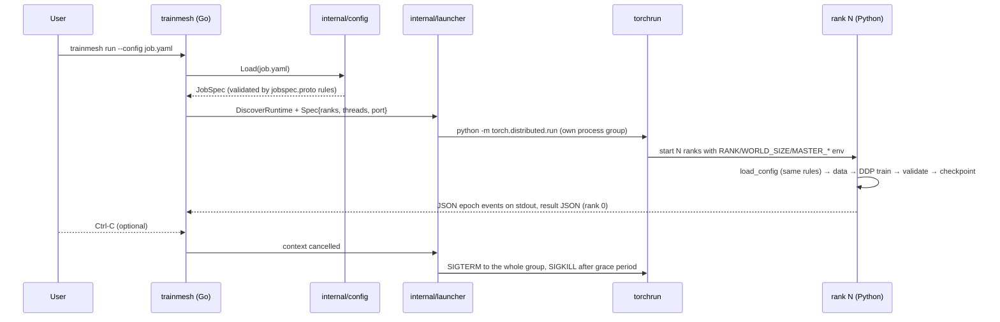

# Module map

What exists in the code today (end of Phase 0), what each module is responsible for, and how a
training run flows through them. Target modules that do not exist yet (`meshd`, `tm-agent`,
`tmcomm`, `tmdata`, …) are described in [TRAINMESH_ARCHITECTURE.md](../TRAINMESH_ARCHITECTURE.md).

| Module | Path | Language | Responsibility | Page |
|--------|------|----------|----------------|------|
| CLI | `cmd/trainmesh`, `internal/cli` | Go | Commands (`doctor`, `plan`, `run`, `benchmark`, `cluster`), signal handling | [cli.md](cli.md) |
| Job schema | `proto/trainmesh/v1/jobspec.proto` + generated code | Protobuf → Go, Python | The one definition of a job config **and** its validation rules | [config.md](config.md) |
| Config loader (Go) | `internal/config` | Go | YAML → `JobSpec`, legacy-key migration, rule check, derived values | [config.md](config.md) |
| Launcher | `internal/launcher` | Go | Finds the runtime, builds torchrun args/env, supervises ranks as a process group | [launcher.md](launcher.md) |
| Training runtime | `python/trainmesh_runtime` | Python | Config, data, DDP training, validation, checkpoints, results | [runtime.md](runtime.md) |
| E2E tooling | `scripts/e2e`, `deploy/docker` | Bash, Python | Local, minikube and physical-machine tests; 1-vs-multi machine comparison | [../E2E_TESTING.md](../E2E_TESTING.md) |

## How `trainmesh run` works, end to end

1. **CLI** reads flags, installs a signal-aware context, and calls the config loader.
2. **Config loader** turns YAML into the generated `JobSpec`, rejects unknown keys, migrates the
   legacy `optimizer:` key, and evaluates every `buf.validate` rule from `jobspec.proto`.
3. **Launcher** locates `.venv/bin/python` and `python/`, picks threads per rank, chooses a free
   rendezvous port and starts `torchrun` in its own process group (retrying if the port is taken).
4. **torchrun** starts one Python process per rank.
5. **Runtime**, in each rank: parses the same config with the same rules, builds the deterministic
   dataset, wraps the model in DDP, trains (one all-reduce per optimizer step), evaluates on the
   held-out validation set, saves a verified checkpoint, and rank 0 writes the result JSON.

Multi-machine runs use steps 4–5 only (torchrun started by hand or by Kubernetes); the CLI and
agent path for several machines is Phase 1.

## Conventions shared by all modules

- **Typed errors with codes.** Go: sentinel errors (`config.ErrInvalid`,
  `launcher.ErrRuntimeNotFound`, `launcher.ErrRendezvousPortUnavailable`); Python:
  `TrainMeshError` subclasses with a `code` (`CONFIG_INVALID`, `CHECKPOINT_INVALID`,
  `REPLICA_DIVERGENCE`). The runtime exits with status 2 and prints `[CODE] message`.
- **Tunables in config, not constants in code.** Anything that varies by deployment is a config
  field or an environment variable with a safe default.
- **Generated code is never edited.** Change `jobspec.proto`, then run `make generate`.
- **Tests sit next to the code** (`*_test.go`, `python/tests/`, `scripts/e2e/test_*.py`).
