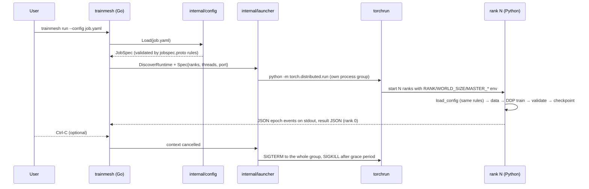

# Module map

What exists in the code today (end of Phase 2), what each module is responsible for, and how a
training run flows through them. Target modules that do not exist yet (`tmcomm`, `tmdata`, the
adaptive planner, …) are described in [TRAINMESH_ARCHITECTURE.md](../TRAINMESH_ARCHITECTURE.md).

| Module | Path | Language | Responsibility | Page |
|--------|------|----------|----------------|------|
| CLI | `cmd/trainmesh`, `internal/cli` | Go | Commands (`doctor`, `plan`, `run`, `benchmark`, `token`, `nodes`, `job`, `cluster`), signal handling | [cli.md](cli.md) |
| Coordinator (`meshd`) | `cmd/meshd`, `internal/coordinator` | Go | Admits machines, liveness, scheduling and planning (device, backend, batch split), job lifecycle, gRPC API with per-method roles | [mesh.md](mesh.md) |
| Agent (`tm-agent`) | `cmd/tm-agent`, `internal/agent` | Go | Joins, benchmarks its devices, heartbeats, runs its node rank of a job, reports results | [mesh.md](mesh.md) |
| Membership | `internal/membership` | Go | Node lifecycle states, legal transitions, heartbeat-age rule (pure) | [mesh.md](mesh.md) |
| Security | `internal/security` | Go | Join tokens and strings, cluster CA, certificates, TLS, caller identity | [mesh.md](mesh.md) |
| Store | `internal/store` | Go | Transactional persistence of tokens, nodes, jobs (bbolt) | [mesh.md](mesh.md) |
| Control API | `proto/trainmesh/v1/coordinator.proto` + generated gRPC code | Protobuf → Go | The `CoordinatorService` contract between CLI, `meshd` and agents | [mesh.md](mesh.md) |
| Job schema | `proto/trainmesh/v1/jobspec.proto` + generated code | Protobuf → Go, Python | The one definition of a job config **and** its validation rules | [config.md](config.md) |
| Config loader (Go) | `internal/config` | Go | YAML → `JobSpec`, legacy-key migration, rule check, derived values | [config.md](config.md) |
| Launcher | `internal/launcher` | Go | Finds the runtime, builds torchrun args/env, supervises ranks as a process group | [launcher.md](launcher.md) |
| Training runtime | `python/trainmesh_runtime` | Python | Config, data, DDP training, validation, checkpoints, results | [runtime.md](runtime.md) |
| Devices and balancing | `trainmesh_runtime/{devices,sync,balance,probe}.py`, `internal/coordinator/planner.go` | Python, Go | Device/precision/backend choice, gradient sync for mixed devices, throughput profiles, per-rank batch split | [devices.md](devices.md) |
| E2E tooling | `scripts/e2e`, `deploy/docker` | Bash, Python | Local, minikube and physical-machine tests; 1-vs-multi machine comparison | [../E2E_TESTING.md](../E2E_TESTING.md) |

## How `trainmesh run` works on one machine

1. **CLI** reads flags, installs a signal-aware context, and calls the config loader.
2. **Config loader** turns YAML into the generated `JobSpec`, rejects unknown keys, migrates the
   legacy `optimizer:` key, and evaluates every `buf.validate` rule from `jobspec.proto`.
3. **Launcher** locates `.venv/bin/python` and `python/`, picks threads per rank, chooses a free
   rendezvous port and starts `torchrun` in its own process group (retrying if the port is taken).
4. **torchrun** starts one Python process per rank.
5. **Runtime**, in each rank: parses the same config with the same rules, builds the deterministic
   dataset, picks its device and gradient sync ([devices.md](devices.md)), trains (one
   all-reduce per optimizer step), evaluates on the held-out validation set, saves a verified
   checkpoint, and rank 0 writes the result JSON.

## How `trainmesh run --coordinator` works across machines

The CLI submits the job to `meshd`; `meshd` picks `execution.workers` READY machines that offer
the job's device, decides the collective backend and (for `balance: throughput`) each rank's
share of the batch, writes that plan into the config, and hands each machine a node rank in its
agent's next heartbeat; every agent runs steps 3–5 above for its own
ranks with `--nnodes/--node_rank/--master_addr` from the coordinator; rank 0's result comes back
through `meshd` to the CLI. Joining, liveness, failure handling and security are explained in
[mesh.md](mesh.md).

## Conventions shared by all modules

- **Typed errors with codes.** Go: sentinel errors (`config.ErrInvalid`,
  `launcher.ErrRuntimeNotFound`, `launcher.ErrRendezvousPortUnavailable`, `security.ErrToken*`,
  `store.ErrNotFound`, `membership.ErrIllegalTransition`) mapped to gRPC codes at the API edge;
  Python:
  `TrainMeshError` subclasses with a `code` (`CONFIG_INVALID`, `CHECKPOINT_INVALID`,
  `REPLICA_DIVERGENCE`). The runtime exits with status 2 and prints `[CODE] message`.
- **Tunables in config, not constants in code.** Anything that varies by deployment is a config
  field or an environment variable with a safe default.
- **Generated code is never edited.** Change the `.proto` files, then run `make generate`.
- **Tests sit next to the code** (`*_test.go`, `python/tests/`, `scripts/e2e/test_*.py`).
