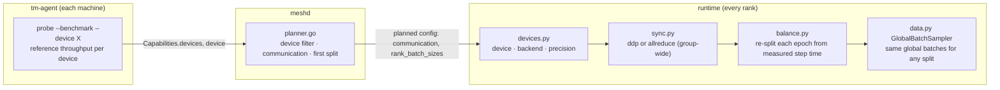

# Devices, precision, gradient sync and throughput balancing (Phase 2)

**Paths:** `python/trainmesh_runtime/{devices,sync,balance,data,probe}.py`,
`internal/agent/host.go` (probe call), `internal/coordinator/planner.go`,
`proto/trainmesh/v1/{jobspec,coordinator}.proto`.

Phase 2 lets one job mix machines with different hardware (CPU, Apple GPU, NVIDIA/AMD GPU) and
gives each machine a share of every global batch that matches its speed. The trained model does
not depend on which devices took part or how the batch was split.

## The pieces and who decides what

| Decision | Made by | When | Why there |
|----------|---------|------|-----------|
| Which devices a machine offers and how fast each is | agent (`tm-agent --device`, probe) | agent start | Only the machine can measure itself |
| Which machines run the job | coordinator `planJob` | submit | Needs every node's profile; refuses nodes that don't offer the requested device |
| Collective backend (`communication: auto`) | coordinator `chooseCommunication` | submit | Ranks deciding alone would disagree (a cuda rank picks nccl, a cpu rank gloo) and never rendezvous |
| First per-rank batch split (`balance: throughput`) | coordinator `apportion` | submit | From reference profiles; a guess that is good enough to start |
| Device, precision of each rank | runtime `devices.choose` | rank start | `device: auto` uses `TRAINMESH_DEVICE`, which the agent sets to the device it offers |
| Gradient sync strategy | runtime `choose_sync` | rank start, after all-gathering every rank's device kind | Every rank must run the same collectives |
| Later splits | runtime `balance.py` | after each epoch | Only the real job shows real speed |

## Devices (`devices.py`)

| `execution.backend.device` | Meaning |
|----------------------------|---------|
| `cpu` | CPU; intra-op threads from `execution.cpu_threads_per_rank` / `OMP_NUM_THREADS` (default 1) |
| `mps` | Apple GPU (Metal) |
| `cuda` | NVIDIA, or AMD with a ROCm build of PyTorch (it reports `cuda` too); rank *r* uses GPU `local_rank % device_count` |
| `auto` | `TRAINMESH_DEVICE` if set (the agent sets it), else the best available: cuda → mps → cpu |

A device that is not available on the machine is a `CONFIG_INVALID` error, not a silent fallback.

| `training.precision` | Effect |
|----------------------|--------|
| `fp32` (default) | No autocast |
| `bf16` | `torch.autocast(dtype=bfloat16)` |
| `fp16` | autocast float16 + `GradScaler`; rejected on cpu |
| `auto` | bf16 on CUDA devices that support it, fp32 elsewhere |

Measured on the development Mac (MLP, torch 2.15): bf16 autocast on CPU was 16–20× slower than
fp32, and fp16 on MPS was slower than fp32. So `auto` only picks bf16 on CUDA.

## Collective backend and gradient sync (`sync.py`)

`communication: gloo` works for every device; `nccl` only for all-CUDA groups (a schema rule
rejects `nccl` without `device: cuda`). Gloo and DDP refuse MPS tensors, so MPS gradients are
**staged** through host memory: flatten → `.cpu()` → all-reduce → copy back.

| Strategy | Used when | How |
|----------|-----------|-----|
| `ddp` | every rank has the same device kind (cpu or cuda), equal batches, no rebalancing | PyTorch DDP: all-reduce overlapped with backward, `no_sync` for accumulation |
| `allreduce` | any rank on MPS, mixed device kinds, unequal batches, or `balance: throughput` | One flattened SUM all-reduce per optimizer step; each rank divides its loss by the **global** batch, so the sum is the exact global-mean gradient whatever the split |

`execution.gradient_sync: ddp` when DDP is impossible is a `CONFIG_INVALID` error naming the
reason. With mixed device kinds, Adam's update rounds slightly differently per device; after each
epoch the runtime measures the largest parameter difference from rank 0
(`max_parameter_drift`, ~1e-8 in the e2e) and re-broadcasts rank 0's parameters.

## Same global batches for any split (`data.py`)

`GlobalBatchSampler` shuffles with `randperm(seed + epoch)` (the same order `DistributedSampler`
uses) and gives step *k* the positions `[k·G, (k+1)·G)`, G = sum of the per-rank sizes. Rank *r*
takes its contiguous slice. So one rank, two equal ranks and a 333/691 split all train on the
same global batches; only float summation order differs. An incomplete final global batch is
dropped.

Batches are fetched with one tensor index per batch (`BatchLoader`), not sample by sample through
a `DataLoader`: the per-sample path cost 3–4 ms per 1024-sample batch, more than the model step,
and made CPU training 2.2× slower (5.5 → 2.5 ms per step at batch 1024, hidden 1024).

## Throughput profiles (`probe.py`, agent)

`tm-agent --device auto|cpu|mps|cuda` (default `auto`: every available device) runs
`python -m trainmesh_runtime.probe --benchmark --device X` at start (≈ 5 s). For each offered
device it times training steps of a reference MLP (256-4096-10, batch 512) the way a mixed mesh
group runs them: batch copied from host memory, gradients flattened and (on MPS) round-tripped
through host memory. It reports the median of three 0.5 s rounds after 5 warm-up steps, because
single runs varied by up to 35%. The node's `device` is its fastest offered device.

`Capabilities.devices` and `device` travel in every heartbeat; `trainmesh nodes` shows
`device`, `samples_per_second` per device and `island`.

**Islands** group nodes whose ranks can share a backend: `nccl-cuda` (device cuda) or `gloo-host`
(cpu, mps). Today islands are reported, and `communication: auto` uses NCCL only when every
chosen node is CUDA. Separate islands joined by `tmcomm` are Phase 3.

## Planning a job (`internal/coordinator/planner.go`)

1. Keep READY nodes that **offer** `execution.backend.device` (`auto` matches all; a node that
   reported no profile — an agent from before Phase 2 — is treated as cpu-only).
2. `pickNodes`: first `workers` by ID, same PyTorch/runtime version.
3. `chooseCommunication`: keep `gloo`/`nccl`; resolve `auto` to `nccl` only if every chosen
   node's effective device is cuda.
4. If `training.batch.balance: throughput` and no explicit `rank_batch_sizes`: weight each rank
   by its node's measured throughput on the job's device, and split
   `per_rank × world_size` with the **largest-remainder method** (`apportion`): parts sum to the
   total exactly, ties go to the lower rank, every rank gets at least 1. A node without a profile
   makes the submit fail with `ErrNoThroughput`. Ranks are weighted as one benchmark process each,
   so keep `processes_per_worker: 1` on GPU machines.
5. The planned values are written into the config every rank receives (JSON, which is valid
   YAML), and stored on the job (`trainmesh job get` shows `communication`, `rank_batch_sizes`).

## Re-splitting on the real job (`balance.py`)

The reference model is not the job's model, and the speed ratio between devices changes with
model and batch size. On the development Mac, MPS was 0.6× one CPU thread at batch 256 and 1.1×
at batch 1024 for MLP 256-1024-10. The probe's 1.7× at hidden 4096 turned out to be about 1× in a
real two-agent job on that Mac, where both agents share the CPU. So with `balance: throughput`:

1. Each rank records the compute time of every optimizer step (wall time minus the timed sync)
   and takes the **median** for the epoch. Per-epoch totals swung by 40% between epochs, and the
   first epoch includes device warm-up.
2. The medians are all-gathered; every rank computes the same `EpochBalance`.
3. If the slowest rank's step is more than `REBALANCE_THRESHOLD` (1.10) slower than the fastest,
   the next epoch's split is `apportion(global, size_r / step_time_r)` (same algorithm as the
   coordinator); otherwise the split stays, so noise does not make it oscillate.
4. `loader.sampler.resize()` keeps the global batch, so the model is unchanged.

The result JSON reports `balance`, the last epoch's `rank_batch_sizes`, and `balance_history`:
per epoch `{epoch, rank_batch_sizes, step_compute_ms, compute_imbalance}`.

## Result fields added in Phase 2

| Field | Meaning |
|-------|---------|
| `device`, `precision`, `collective_backend`, `gradient_sync` | What rank 0 resolved |
| `balance`, `rank_batch_sizes`, `balance_history` | Split mode, last split, per-epoch splits |
| `mixed_devices`, `max_parameter_drift` | Whether device kinds differed, and the drift measured before each realignment |
| `ranks` | Per rank: `device`, `batch_size`, `compute_seconds`, `sync_seconds` |
| `compute_imbalance` | Slowest rank's total compute over the fastest's for the run |

## Not done in Phase 2

- **CUDA, NCCL and ROCm are written but not run on hardware** (no NVIDIA/AMD GPU here). Unit
  tests cover the selection logic; the first run on a GPU machine is the acceptance test.
- No `torch.compile`, no FLOPs/memory profiling, no link (bandwidth/latency) matrix: the profile
  is one reference throughput per device.
- Rank weights assume one benchmark process per rank; several ranks sharing one GPU are
  over-weighted until the runtime re-splits them.
- Rebalancing works per epoch. Jobs with one long epoch only get the coordinator's split.

## Tests

- Go: `internal/coordinator/planner_test.go` (apportion cases, device filter, communication for
  the whole group, profile-based split written into a config that parses, missing profile).
- Python: `tests/test_devices.py` (precision, `TRAINMESH_DEVICE`, unavailable device, backend,
  staging, sampler equivalence and resize), `tests/test_balance.py` (the same apportion cases
  as Go, re-split, threshold), `tests/test_runtime.py` (uneven split = uniform model, cpu+mps
  ranks train one model, throughput re-split leaves the model unchanged).
- E2E: `scripts/e2e/devices-local.sh` ([E2E_TESTING.md](../E2E_TESTING.md) level 1c).
