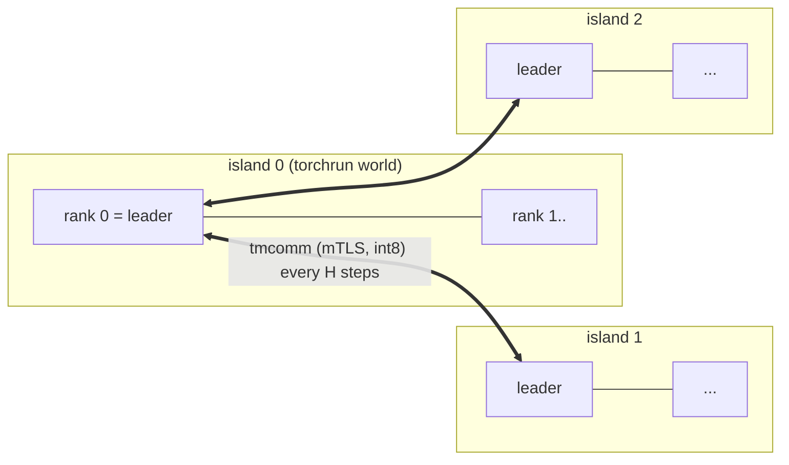

# DiLoCo across islands (Phase 3)

**Paths:** `python/trainmesh_runtime/diloco.py`, `internal/coordinator/islands.go`,
`internal/agent/runner.go` (island environment), `proto/trainmesh/v1/jobspec.proto`
(`execution.diloco`), transport in [tmcomm.md](tmcomm.md).

Data-parallel training all-reduces the full gradient every step, which needs a fast link. Over a
WAN that link is the bottleneck: in the WAN e2e (50 ms RTT, 100 Mbit/s) data-parallel ranks spent
97% of their time waiting. DiLoCo (Douillard et al., 2023) lets groups of machines (**islands**)
train on their own for H steps and then average only their *pseudo-gradients*, so traffic drops
by H× (and 4× more with int8).

## How a job runs

1. **Coordinator** (`formIslands`): the chosen nodes, in ID order, are cut into
   `workers / machines_per_island` islands. Island *k* gets its own torchrun master (its first
   node, port `--rendezvous-port + k`) and its leader's tmcomm endpoint (port
   `--tmcomm-port + k`, default 29700 + k). Every node's Start directive carries its island,
   its node rank *within the island* and every leader's `(island, host:port, node ID)`.
2. **Agent** (`TorchRunner.environment`): launches torchrun for the island only and sets
   `TRAINMESH_ISLAND`, `TRAINMESH_ISLAND_PEERS` (JSON), `TRAINMESH_TMCOMM_LISTEN` (its advertised
   address + port) and `TRAINMESH_TLS_CERT/KEY/CA` (its node identity files).
3. **Runtime** (`OuterLoop`): islands train on **disjoint data**: island *k* of *K* takes global
   batches *k, k+K, k+2K, …* of the shuffled order, so together they cover the same samples per
   epoch as one data-parallel group. Inside the island, gradients are synchronised every step as
   usual (DDP or all-reduce). After every H inner optimizer steps:
   - every rank computes `pseudo = anchor − current` (anchor = weights at the start of the
     round, CPU float32);
   - the island leader calls `tmcomm.all_reduce_mean(round, pseudo, sha256(anchor))`;
   - the leader broadcasts a status flag, then the mean, to its island (so a failed round raises
     `OuterSyncError` on every rank instead of hanging them);
   - every rank applies the **outer step**: Nesterov SGD, `m = μ·m + g`,
     `anchor −= lr·(g + μ·m)`, and loads the anchor into the model.
   The inner optimizer (Adam/SGD) keeps its state across rounds. After the last epoch a final
   round runs, so every island ends with the same model; validation is then re-run on it.

## Settings (`execution.diloco`)

| Field | Default | Meaning |
|-------|---------|---------|
| `inner_steps` | 100 | H: inner optimizer steps per outer round |
| `outer_learning_rate` | 0.7 | Outer Nesterov SGD learning rate (paper value) |
| `outer_momentum` | 0.9 | Outer momentum |
| `compression` | `int8` | `none`, `bf16`, `int8` (with error feedback) |
| `machines_per_island` | 1 | Machines synchronised every step; `workers` must be a multiple |
| `min_islands` | majority | Islands that must contribute each round and finish the job |
| `round_timeout_seconds` | 120 | How long the root waits for contributions (first round: 3×) |

Rules checked by the schema: `strategy: diloco` needs `workers % machines_per_island == 0` and
`min_islands ≤ islands`. Resuming a diloco job is refused for now (the anchor and outer momentum
are not checkpointed; Phase 5).

## Failure semantics

| Event | Result |
|-------|--------|
| A machine of island *k* fails or is lost | Island *k* fails; its other machines are cancelled; the other islands keep training |
| The failed island was the tmcomm root | The others elect the next-lowest island as root and repeat the round |
| Fewer than `min_islands` islands left | tmcomm raises `QuorumLost`; the job FAILS ("*f* of *K* islands failed, *m* must finish") |
| Islands disagree on the anchor digest | `Diverged`: the round is aborted on every island, the job fails |

The job SUCCEEDS when every island has finished and at least `min_islands` succeeded. Its result
is the lowest succeeded island's leader result, whatever order reports arrive in.
`trainmesh job get` shows each island's state, master and tmcomm address. Data-parallel jobs are
the special case of one island that must finish, so the same rules apply to both.

## Result fields

`strategy`, `compute_utilization` (compute ÷ (compute + all communication) on rank 0; `null` for
DDP, which hides its all-reduce inside backward) and `diloco`: `island`, `islands`, `quorum`,
`inner_steps`, `compression`, `outer_learning_rate`, `outer_momentum`, `rounds`,
`outer_seconds`, `bytes_sent`, `bytes_received`, `parameters`, `last_members`, `alive`, and
`rounds_history` (round, root, members, seconds). The leader also prints one
`{"event": "outer_round", ...}` line per round.

## Limits

- Rounds are synchronous: the slowest island sets the pace. Islands of very different speed
  would need per-island H or asynchronous rounds (not built).
- Per-island batch splitting (`balance: throughput`) happens inside each island at runtime; the
  coordinator's profile-based split is skipped for diloco because islands are separate worlds.
- `communication: auto` is resolved over all chosen nodes, so an all-CUDA island in a job with a
  CPU island also uses Gloo.
- No NAT traversal or relay yet: island leaders must reach each other's tmcomm port directly.

## Tests

- Python `tests/test_diloco.py`: layout parsing; island data sharding (disjoint, covering one
  epoch); **three real island processes** through tmcomm finish with identical model hashes,
  ≥ 85% accuracy and ~1 byte per parameter per round; **killing an island** after its first
  round leaves the other two finishing with members `[0, 1]`; a single local island.
- Go `internal/coordinator/islands_test.go`: island formation and ports, schema rules, quorum
  settlement, cancelling a failed island's other machines, Start directive contents;
  `mesh_test.go`: real meshd + 3 agents, island 2 fails, job SUCCEEDS with island 0's result.
- E2E `scripts/e2e/wan.sh` (level 4 in [E2E_TESTING.md](../E2E_TESTING.md)).
