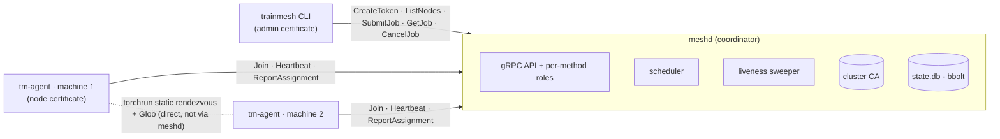
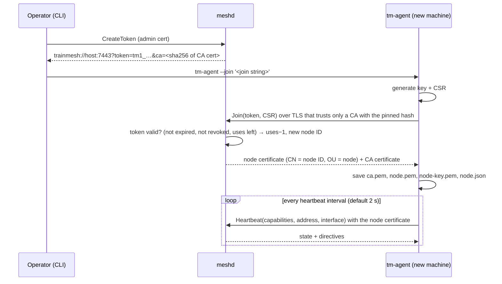
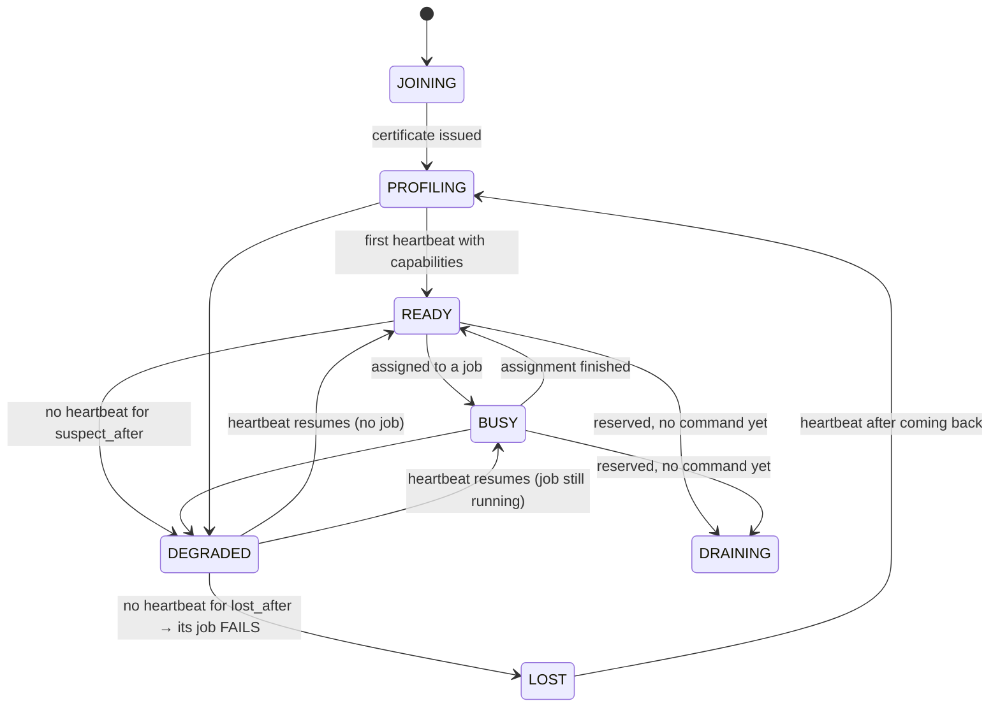

# Mesh: coordinator, agents, membership and security

**Paths:** `cmd/meshd`, `cmd/tm-agent`, `internal/coordinator`, `internal/agent`,
`internal/membership`, `internal/security`, `internal/store`,
`proto/trainmesh/v1/coordinator.proto`.

This is what turns several computers into one training cluster on a LAN: machines join with a
token, report health, and run one training job together through the `trainmesh` CLI.

## Components



| Component | Package | Responsibility |
|-----------|---------|----------------|
| `meshd` | `internal/coordinator` | Admits machines, tracks liveness, schedules jobs, relays results. Owns the CA and the state file |
| `tm-agent` | `internal/agent` | Joins once, benchmarks the devices it offers (`--device`), heartbeats, runs this machine's part of a job via the launcher, reports outcome |
| Membership | `internal/membership` | Pure node lifecycle: states, legal transitions, heartbeat-age rule |
| Security | `internal/security` | Join tokens, join strings, CA, certificates, TLS configs, caller identity |
| Store | `internal/store` | Transactional persistence of tokens, nodes and jobs (one bbolt file) |

Agents only make **outgoing** connections. Work reaches them in heartbeat *responses*
(directives), so machines need no inbound control port. Training traffic itself (torchrun's
rendezvous and Gloo) goes directly between machines, never through `meshd`.

## Joining a machine



- **Token:** 32 random bytes, `tm1_` prefix, single use by default, 15-minute TTL. Only its
  SHA-256 is stored, and redeeming it happens in the same transaction that decrements its uses,
  so a single-use token cannot be used twice.
- **Join string:** `trainmesh://host:port?token=…&ca=…`. The `ca` hash lets the new machine
  trust the coordinator on first contact without copying any file; a coordinator with a
  different CA is refused.
- **Identity:** the coordinator chooses the node ID and role; whatever the CSR claims is ignored.
- **Capabilities** (hostname, OS, CPUs, memory, PyTorch and runtime versions) come from
  `python -m trainmesh_runtime.probe` in the same environment that will train.
- **Address and interface** default to the route the OS uses to reach the coordinator
  (`DetectRoute`); override with `--address` / `--interface`.

## Node lifecycle



Defaults: heartbeat 2 s, `suspect_after` 6 s, `lost_after` 20 s, sweep every 1 s (all
`meshd` flags). Only `READY` nodes can be assigned.

## Running a job across machines

1. `trainmesh run --config job.yaml --coordinator host:7443` validates the config locally and
   calls `SubmitJob`.
2. The planner (`planJob`, [devices.md](devices.md)) keeps READY nodes that offer the job's
   device; `pickNodes` takes `execution.workers` of them, ordered by ID, and refuses mixed
   PyTorch/runtime versions. The planner resolves `communication: auto` for the whole group and,
   for `balance: throughput`, splits the batch by measured throughput; both are written into the
   config sent to the agents. Node rank 0 is the first; its address becomes `master_addr`, and
   `--rendezvous-port` (default 29500) the `master_port`. The job is `RUNNING` and the nodes
   `BUSY`, in one transaction.
3. Each agent's next heartbeat carries a **Start** directive (repeated until the agent reports
   `RUNNING`, so a lost response is harmless; agents ignore duplicates). The agent writes the
   config into `jobs/<job-id>/`, and its `TorchRunner` launches
   `torchrun --nnodes=N --node_rank=r --nproc_per_node=… --master_addr=… --master_port=…`
   with `GLOO_SOCKET_IFNAME` set to its interface and `TRAINMESH_DEVICE` to the device it offers
   (used by `device: auto`). Output goes to `jobs/<job-id>/runtime.log`.
4. Agents report `RUNNING`, then `SUCCEEDED` (rank 0 attaches its result JSON) or `FAILED` /
   `CANCELLED`. Reports retry 5 times with backoff.
5. The CLI polls `GetJob`, prints each change, and prints rank 0's result JSON on success.
   Ctrl-C or `--timeout` cancels the job on every machine.

## Failure handling

| What happens | Detection | Outcome |
|--------------|-----------|---------|
| One rank crashes | its agent reports `FAILED` | Job `FAILED` with that node's message; other agents get **Cancel** on their next heartbeat, stop their process group, report `CANCELLED`, return to READY |
| A machine dies or freezes | no heartbeats: `DEGRADED`, then `LOST` | Its assignment and the job `FAIL` ("node lost"); others are cancelled as above |
| A peer fails before another node even started | settled in the same transaction | Never-started assignments become `CANCELLED` and their nodes are freed immediately (regression test `TestFailureBeforeAPeerStartedReleasesThatPeer`) |
| Operator cancels | `trainmesh job cancel` / Ctrl-C | Job `CANCELLED`; agents stop on their next heartbeat |
| Agent restarts | identity is on disk | Rejoins with its certificate; a `LOST` node goes back through PROFILING to READY |
| Coordinator restarts | state in `state.db` | Nodes, tokens and jobs survive; agents keep heartbeating once it is back |

Jobs are not resumed automatically after a failure: the checkpoint lives on node rank 0's disk.
Re-submit with `run.resume` once the cluster is healthy (automatic recovery is Phase 5).

## Security model

- TLS 1.3 everywhere, with ECDSA P-256 keys and a cluster CA created by `meshd` on first start
  (`ca.pem`, `ca-key.pem` in its state dir, key 0600).
- `meshd` issues itself a server certificate for the advertise host plus localhost on every
  start, and an admin client certificate once (`admin.pem`, `admin-key.pem`) for the CLI.
- Clients trust a server only if its chain reaches the cluster CA, it has the server-auth
  usage **and** it is the coordinator's certificate (CN `meshd`, no member role). Host names are
  not checked, because machine addresses change; the CA is the trust anchor.
- Node certificates name the node ID as a DNS name and allow both client and server auth (since
  0.5), so DiLoCo island leaders can authenticate each other over tmcomm
  ([tmcomm.md](tmcomm.md)). The coordinator-identity check above is what still stops a node
  certificate from impersonating `meshd` (tested). Agents that joined before 0.5 must join again
  to run diloco jobs.
- **Authorization** is one table (`methodRoles` in `internal/coordinator/auth.go`): `Join` is
  anonymous; `Heartbeat` and `ReportAssignment` need a node certificate; everything else needs
  the admin certificate. A method missing from the table is denied.
- A node can only report on its own assignments (checked against its certificate's CN).
- Not yet: certificate renewal (node certificates last 30 days), token revocation and node
  removal commands, and authentication of torchrun/Gloo traffic inside an island. Traffic
  between islands (tmcomm) is mTLS.

## Operating it

```bash
# machine A: coordinator (state in ~/.trainmesh/meshd)
meshd --listen 0.0.0.0:7443 --advertise 192.168.1.10:7443
trainmesh token create --coordinator 192.168.1.10:7443   # prints a join string

# every training machine (in a TrainMesh checkout with .venv); --device defaults to auto
tm-agent --join 'trainmesh://192.168.1.10:7443?token=…&ca=…' [--device cpu|mps|cuda]

# machine A
trainmesh nodes --coordinator 192.168.1.10:7443
trainmesh run --config job.yaml --coordinator 192.168.1.10:7443 --output result.json
trainmesh job get <job-id>  |  trainmesh job cancel <job-id>
```

`TRAINMESH_COORDINATOR` and `TRAINMESH_ADMIN_DIR` set the defaults for `--coordinator` and
`--admin-dir`. Every machine needs the same TrainMesh commit and PyTorch version (and the
`tmcomm` extension, `make native`, for diloco jobs). TCP must be open from every machine to
`meshd` (7443) and to its island's rendezvous port (`--rendezvous-port` + island), between the
machines of an island for Gloo, and between island leaders on `--tmcomm-port` + island
(default 29700 + island).

**Islands.** Every job has islands: a data-parallel job is one island that must finish; a diloco
job has `workers / machines_per_island` islands, each its own torchrun world, of which
`min_islands` must finish. A failed machine fails only its island; the job fails when too few
islands remain. See [diloco.md](diloco.md).

## Tests

- `internal/membership`, `internal/security`, `internal/store`: unit tests (every transition,
  token rules, join strings, real TLS handshakes incl. wrong CA and impersonation, store
  round trips and rollback).
- `internal/coordinator/server_test.go`: deterministic scheduler and job-settlement tests.
- `internal/coordinator/planner_test.go`: device filter, group-wide backend, batch split.
- `internal/coordinator/islands_test.go`: islands, ports, quorum settlement, island cancel.
- `internal/coordinator/mesh_test.go`: real `meshd` + real agents over mTLS in-process (fake
  training runner): join and run, single-use tokens, wrong CA, role checks, failure
  cancellation, a silent node going LOST, not enough nodes.
- `scripts/e2e/mesh-local.sh` and `scripts/e2e/minikube.sh mesh`: real binaries and real
  training; see [E2E_TESTING.md](../E2E_TESTING.md).
