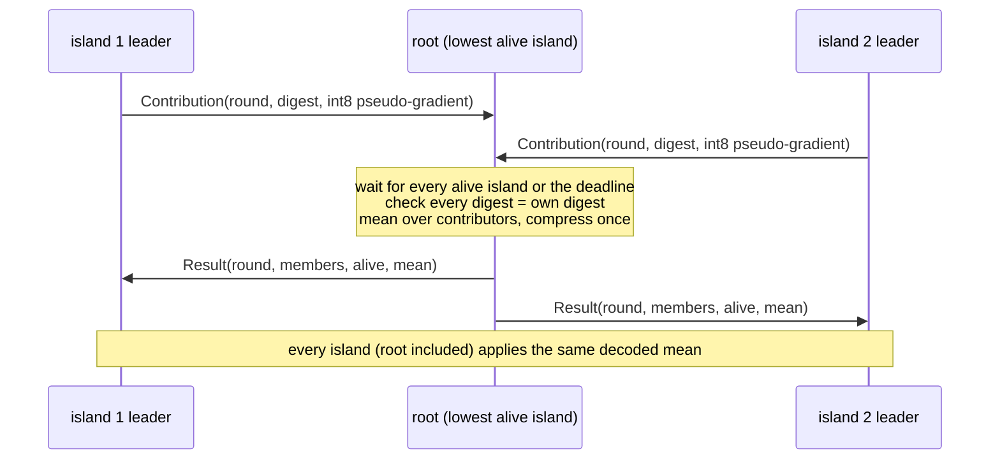

# tmcomm: communication between islands (Rust)

**Paths:** `native/tmcomm/` (Cargo workspace `native/`), Python module `tmcomm` built with
maturin (`make native`). Used by [diloco.md](diloco.md).

Inside an island, ranks synchronise every step with PyTorch collectives over a fast link. Between
islands the link may be a slow WAN, so DiLoCo synchronises only every H steps, and tmcomm makes
that exchange **small** (compressed), **authenticated** (mTLS with the cluster CA) and **tolerant
of island loss** (quorum and root failover). It is the first piece of the Rust data plane from
the architecture (§5.8); NAT traversal, QUIC and a PyTorch `ProcessGroup` are not built yet.

| File | Responsibility |
|------|----------------|
| `src/codec.rs` | `f32`, `bf16`, `int8` encodings; `ErrorFeedback` |
| `src/wire.rs` | Length-checked binary frames: `Hello`, `Contribution`, `Result`, `Abort` |
| `src/tls.rs` | rustls TLS 1.3 server and client configs from the node's PEM files; peer-name check |
| `src/group.rs` | `OuterGroup`: the outer all-reduce with quorum, root election and failover |
| `src/python.rs` | PyO3 bindings (`python` feature), GIL released while waiting on the network |
| `src/error.rs` | Typed errors: `QuorumLost`, `Diverged`, `Excluded`, `Aborted`, `Protocol`, `Tls`, `Config`, `Io` |

## Codecs and error feedback (`codec.rs`)

| Codec | Bytes per value | Error per value |
|-------|-----------------|-----------------|
| `none` (f32) | 4 | none |
| `bf16` | 2 | ≤ 2⁻⁹ relative (round to nearest even) |
| `int8` | 1 + 4 per 1024 values | ≤ scale/2, scale = chunk absmax / 127 (each 1024-value chunk has its own scale) |

Non-finite values are refused (a NaN pseudo-gradient means training diverged; sending it would
poison every island). **Error feedback:** what compression dropped in a round is added to the
next round's input, so the error does not accumulate. Example from the unit test: 0.3 next to
100.0 in one int8 chunk rounds to 0 every time without it, but averages to 0.3 ± 0.001 over
1000 rounds with it.

## Wire format (`wire.rs`)

Little-endian frames starting with `TMC1` and a kind byte. Every count is checked against
`max_values` (the model size) and against the codec's exact layout **before** anything is
allocated, so a peer cannot make a leader allocate arbitrary memory or misparse a payload.

## One round (`group.rs`)



- **Root** = lowest-numbered island still alive. Every leader keeps a listener; members connect
  to the root over mTLS and send `Hello{island}` first.
- **Identical updates:** the root compresses the mean once and applies the *decoded* value
  itself, so all islands apply bit-identical updates. Each contribution carries a SHA-256 of the
  island's anchor weights; any mismatch aborts the round with `Diverged` instead of silently
  training different models.
- **Lost root:** a member that sees the root's connection close, or gets no result within
  2 × round timeout + connect timeout, drops the root and repeats the round with the next-lowest
  island. The root sends results lowest island first, so if any member got the result, the next
  root most likely did too; it answers a retried contribution with the cached result.
- **Lost member:** the root drops an island whose connection closes, or that never connected by
  the deadline. A connected but slow island just misses the round (its contribution is not in
  that mean) and stays alive.
- **Quorum:** every round needs `quorum` contributors (default: a majority of islands), so two
  halves of a partitioned group can never both continue. Below quorum → `QuorumLost` for
  everyone still connected.
- **Timeouts:** first round uses `startup_timeout` (islands may still be loading PyTorch), later
  rounds `round_timeout`; connects retry every 200 ms up to `connect_timeout`.

## Security (`tls.rs`)

TLS 1.3 only, `ring` provider. Both sides present the agent's node certificate (`node.pem`,
`node-key.pem`) and trust only the cluster CA (`ca.pem`). Since Phase 3, node certificates carry
the node ID as a DNS name and both server and client auth (see [mesh.md](mesh.md)):

- the dialling leader checks the root's certificate is valid for the root's node ID;
- the accepting leader checks the dialler's certificate is valid for the node ID of the island
  it claims in `Hello` (a valid certificate for another node is refused — tested).

Plaintext is allowed only when every peer address is loopback (single-machine tests).

## Python API (`python.rs`)

```python
import tmcomm
group = tmcomm.OuterGroup(
    island=0, peers=[(0, "10.0.0.1:29700", "node-a"), (1, "10.0.0.2:29701", "node-b")],
    listen="10.0.0.1:29700", quorum=2, max_values=n, codec="int8",
    tls=("node.pem", "node-key.pem", "ca.pem"),
    round_timeout=120.0, startup_timeout=360.0, connect_timeout=10.0)
report = group.all_reduce_mean(round, flat_float32_numpy, sha256_digest)  # in place
# report: {round, root, members, alive, bytes_sent, bytes_received, seconds}
group.close()
```

Errors are `tmcomm.QuorumLostError`, `DivergedError`, `ExcludedError` (all subclasses of
`TmcommError` ⊂ `RuntimeError`) or `ValueError` for bad arguments. The wheel is abi3 for
Python ≥ 3.11 (the buffer protocol entered the stable ABI in 3.11).

## Building and testing

```bash
make native      # maturin develop --release into .venv (needs cargo)
make test-rust   # cargo test: 12 unit + 8 integration tests
make lint        # includes cargo fmt --check and clippy -D warnings (with and without python)
```

Integration tests (`tests/group.rs`) run real leaders on loopback threads: three islands agree on
the exact mean; int8 means are bit-identical on every island and cost ~1 byte per value; losing
the root elects island 1; losing two of three islands raises `QuorumLost`; a digest mismatch
raises `Diverged`/`Aborted`; plaintext to a remote address is refused; mTLS with an rcgen CA
works; a certificate issued to another node is refused.
